# Σ — The Convergence Certificate

> **Moved 2026-09-29:** research code and data this document cites that is no longer in this repo lives at the same path in the private [lantern-os-research](https://github.com/alex-place/lantern-os-research) repo, with its history. Those paths are marked **†** below.

*What this project has proved, measured and corrected about collapse and grounding in its own loop. The standard results it rests on are cited in [Sources](#sources--what-this-rests-on), not restated.*

> **This is the condensed edition (2026-11-05).** Every standard result, method or framing that earlier versions restated is now one row of [Sources](#sources--what-this-rests-on), cited in the text as [1]–[26]. What remains is the project's own work: theorems about its engine, measurements on its systems, the items its prior-art audits left standing, and its corrections. Section numbers are unchanged, so `§1.2.3`, `§3`, `§8.4` and the rest still name the same topics. The maintenance log and the original router design sketch were provenance, not results, and are no longer in this file. The full previous text (2,923 lines) is at [commit 6a5f028c](https://github.com/alex-place/lantern-os/blob/6a5f028ced26be397a420bf1bb7dc09852cd9a03/docs/SIGMA0-COLLAPSE-CERTIFICATE.md). The cut changes no theorem, evidence class or measured number, which an independent comparison of the two versions checked, and the in-repo test counts were re-run for it.

> **Correction — 2026-11-05 (read before citing anything below).** An engine-level audit, including an independent one (`lantern-os-research` PR #1), found several headline claims stronger than their evidence, and shipped code that violated some of the theorems. The code is fixed and pinned by tests; [Appendix C](#appendix-c--corrections-register-consolidated) lists every correction. In short: the "900/900 prevented" figure is **retired** (a placebo scored the same); C3 is about the gate, not the state; "no third fate" is false even in the linear regime (rotation); the small-gain "proven bound" bounded nothing; and the former acceptance proxy tracked the size of the hidden state rather than its dynamics. The companion proofs in the private research repo (`SIGMA0-C3-…`, `SIGMA0-T1-…`, `SIGMA0-L2-…`) still carry the older wording.

**One object, two timescales.** Part I (§0–§7) concerns the fast state `x`, the hidden-state trajectory inside one forward pass, with the slow parameters `θ` held fixed; it is PROVEN where a status line says so. Part II (§8) concerns the slow weights `θ`, how the model changes across updates. It is a gate built on imported theorems, with no machine-checked theorem of its own, and must never be read with Part I's authority. Part III (§9) composes the two, as a target. Part IV (§10) is a design, below Part II in authority, with two measured datapoints and no proofs.

## What this document is — and is not

**It is** the evidence-classed theory record for the *Verify* stage of one system: the stability machinery of a local-first reasoning loop ([unisona.ai](../CLAUDE.md), repo `alex-place/lantern-os`). Alex Place writes it with AI coding agents, which draft and revise under the operator's review. The dates are real project dates.

**It is not** peer-reviewed. Outside review so far consists of adversarial model passes and the operator's own (§8.7, Appendix C).

**What counts as ours.** Novelty is graded per item, never claimed or disclaimed wholesale; that has been the policy since 2026-07-22. Three prior-art passes over the theory found **no novel mechanism**: the 2026-07-07 nearest-prior audit, the 2026-07-17 corner audit and the 2026-07-18 conventional-grounding pass. "Ungrounded self-reference degrades, and external verification is the escape" is published [12], and the dynamical tools are standard or published elsewhere [1–11]. The registry audits ([#2860], [#2861], [#2874]) then promoted two items, R3 and R9, to AUDITED-CANDIDATE, each with a narrowed scope. What the project contributes:

1. **Theorems about its own engine:** C3 and S1 (§3). Their ingredients are standard [8]. The 2026-07-17 corner audit found no located counterpart for C3 itself, while the 2026-07-18 pass filed it with established method, so it carries no novelty grade. Both live on this synthetic SDE, not on a real model.
2. **Measurements on its own systems:** Ouro-1.4B's latent loop, a trained reservoir, the operator against a placebo, the honesty benchmark, and the holdout-reuse simulations.
3. **Negative results.** Each correction in Appendix C was found by a falsification pass or an independent review, and the correction is what ships.
4. **Candidate-novel items**, graded on the registry's ladder: `NOT-NOVEL` (imported, no claim) · `CANDIDATE ★` (possibly novel; a bounded prior-art search is owed) · `AUDITED-CANDIDATE ✓` (survived a recorded, bounded search). ✓ is the strongest status this document gives itself; "proven novel" needs outside review.

**Evidence classes.** PROVEN: a proof, machine-checked as defined next. MEASURED: an empirical result with a run pointer. HEURISTIC: an operational design, not derived from a theorem. TARGET and DESIGN: stated, not shown. **"Machine-checked"** means closed-form algebra, numerical sweeps and `pytest`; only C3's abstract form is also checked in Lean (`docs/formal/C3EngineLift.lean`). PROVEN means proven *in-regime*: a local linear Jacobian under the stated hypotheses.

**Process disclosure.** An early draft, written while the search backend was down, carried four fabricated arXiv IDs (2406.07284, 2402.07827, 2309.07864 and 2309.01219, none matching its claimed title). Source verification caught them on 2026-06-17 ([#660]). The record stays because it is the plainest evidence for this document's central claim: self-generated content is untrustworthy until something outside checks it.

## How to audit this document

Every load-bearing claim maps to a runnable artifact. The pytest rows marked *here* were re-run on 2026-11-05: 980 tests, all passing. The Lean row and the placebo script were last run on 2026-11-05, by the changes that added them. Rows marked † run only in the private research repo, so a clone of this repo cannot check them; they were last run on the date given.

| Claim | Class | Runs | Verify with |
|---|---|---|---|
| Theorem 1, spectral dichotomy, C3 anti-freeze, the σ-axis, §2 operator behaviour (§1–§3, §7.1) | PROVEN in-regime | here | `python -m pytest tests/test_cio_sde.py -q` → 54 passed |
| C3 and S1 through the real engine, per trajectory: the cap, per-sample floors, every dimension, no consecutive gate for any row, `x*` and the kick on `null(A)`, mixed batches, per-row budgets and receipts, batch rows equal to lone runs (the anisotropy and the C3 floor bit for bit alone or in any batch; whole runs bit for bit where the matrix products are exact, as at the tested inputs, and to rounding elsewhere), a non-finite row left alone and kept out of the surprise monitor's Cholesky, the placebo pin, the scope limit (§2–§3) | PROVEN in-regime + engine tests | here | `python -m pytest tests/test_sigma0_c3_engine.py -q` → 94 passed |
| C3 in abstract form: L2′ for any projector, scale invariance, the Popoviciu floor bound, the shipped constants (`1.02`, `ε_a = 1/20`, `ρ ≤ 9·10⁻⁴`, every `d ≥ 2`), rank feasibility, gate off (§3) | PROVEN, Lean 4 + Mathlib (standard axioms only; six false variants rejected) | here | `lake env lean docs/formal/C3EngineLift.lean` against Mathlib v4.27 (setup in the file header) |
| The bridge from that proof to the engine (§3) | tested (spectral identities, not formalized) | here | `python -m pytest tests/test_sigma0_c3_formal_bridge.py -q` → 26 passed |
| Certificate fates against the actual flow, in any basis and next to large modes (§1) | tested | here | `python -m pytest tests/test_sigma0_certificate_fates.py -q` → 609 passed |
| Non-normal stability gates: no false-positive certificate over 400 matrices; each bound checked against the matrix exponential (§1.2.1) | tested | here | `python -m pytest tests/test_stability_gates.py -q` → 14 passed |
| Loop-contraction verdict on known contractions, non-finite iterates, saved Ouro residuals, and `generate()` on a stub backbone (§1.2.3) | MEASURED signal; no live model | here | `python -m pytest tests/test_sigma0_loop_contraction.py -q` → 171 passed |
| JSRR telemetry and fallback verdict (§1.2.3) | verdict machine-checked | here | `python -m pytest tests/test_sigma0_jsrr_gate.py -q` → 12 passed |
| Placebo-controlled operator measurement (§3) | MEASURED (simulation) | here | `python experiments/sigma0_placebo_control.py --trials 10` |
| Four-signal trigger calibration: precision 1.0, recall ≈ 0.08 (§2, [#1990]) | MEASURED on the batch gate; needs a re-run | †, 2026-07-04 | `python experiments/sigma0_trigger_calibration.py`, once it scores each row (§2) |
| Region of attraction on a textbook benchmark (§5, [#1991]) | PROVEN (interval arithmetic) | †, 2026-07-17 | `python -m pytest tests/test_sigma0_roa_certified.py -q` → 4 passed |
| Scheduled-vs-reactive grounding race (§3.1, [#2690]) | MEASURED | †, 2026-07-17 | `python -m pytest tests/test_sigma0_scheduled_grounding.py -q` → 6 passed |
| Prospective shot-call on the trained reservoir (§3.1, [#2690]) | MEASURED (real learned system) | †, 2026-07-17 | `python -m pytest tests/test_sigma0_reservoir_deadline.py -q` → 5 passed |
| Σ_θ release-gate logic and A/B/C decision tree (§8.1.2) | machine-checked logic | †, 2026-07-17 (self-test 2026-07-07) | `python experiments/sigma_theta_abc/harness.py --self-test`; `python -m pytest tests/test_sigma_theta_gate.py -q` → 11 passed |
| Holdout staleness and the Thresholdout third road (§8.4) | MEASURED (simulation) | †, 2026-07-17 | `python -m pytest tests/test_sigma_theta_thresholdout.py -q` → 7 passed |
| Internal signals cannot extend the selection budget (§8.4.1) | MEASURED (simulation) | †, 2026-07-07 | `python experiments/sigma_update_internal_signal_value.py` |
| The freshness law's kill test fired: re-drawn noise de-ratchets (§8.4.1, [#2692]) | MEASURED (simulation) | †, 2026-07-17 | `python -m pytest tests/test_sigma_update_stochastic_signal.py -q` → 6 passed |
| Promotion-evidence protocol at task-level stuck fidelity (§8.6 item 4, [#2691]) | machine-checked protocol; MEASURED (simulation) | †, 2026-07-17 | `python -m pytest tests/test_sigma_theta_holdout_protocol.py -q` → 6 passed |
| Incremental validity on a real model (§8.6 item 5) | MEASURED (one model) | †, 2026-07-07 | `experiments/sigma_incremental_validity_ouro.py` (local GPU, cached Ouro-1.4B, ~25 min; run log in PR #2240) |
| The freshness law on a live code surface (§10.1) | MEASURED instance (one run) | †, 2026-07-21 | `data/autowork-runs/2026-07-21.jsonl`; PR #2795 |
| The act-to-know loop, built and run (§10.2) | MEASURED (mechanism) + unit-tested | †, 2026-07-21 | `python -m pytest tests/test_oracle_active_loop.py -q` → 7 passed |
| Σ_θ controlling a *real* training run; §9's composition; Part IV against a frontier-model baseline | **not yet verifiable** | — | open (§8.6, §9, §10.2) |

If a *here* command fails on a fresh clone, the document has drifted from the code and should not be trusted until reconciled. That is the intended failure mode.

## Glossary — internal names → standard terms

| Internal | Standard meaning |
|---|---|
| Σ₀ | the four-signal collapse *trigger*, an operational representational-collapse detector (§2), and by extension the project's grounding discipline |
| Σ₀⁻¹ | the anti-collapse *re-excitation operator*: a state kick and covariance bump on the trajectory's near-null subspace (§3), inspired by persistent excitation [7] |
| Σ_θ | the Model-Update Acceptance Gate, a checkpoint-promotion gate for weight updates (Part II) |
| "42-state" | colloquial name for the degenerate frozen state, the projection onto `null(A)`; no formal meaning (§2) |
| collapse | representational or model collapse [12]; locally, loss of contraction structure in the linearized dynamics |
| unisona.ai, Lantern, Unisona | project code names, with no technical content |

## Contents

| | Section | Status |
|---|---|---|
| — | [Plain-language summary](#plain-language-summary) | what is ours, and what is left |
| — | [Sources](#sources--what-this-rests-on) | the prior art, one row per result |
| — | [Formula registry](#the-mathematics--formula-registry) · [the loop, stage by stage](#the-loop-stage-by-stage) | epistemic and novelty status per formula |
| **I** | Fast state `x`: [§1 fates](#1-the-collapse-guarantee-theorem) · [§1.2.3 loop verdict](#123-the-acceptance-verdict-measured-loop-contraction-with-jsrr-ρ--1-as-fallback) · [§2 trigger](#2-the-collapse-trigger-σ₀) · [§3 operator, C3 and S1](#3-the-anti-collapse-operator-σ₀¹) · [§3.1 scheduled grounding](#31-design-implication-scheduled-grounding-from-certificate-quantities) · [§4 canary](#4-the-early-warning-scalar-the-canary) · [§5 basins](#5-global-structure-the-attractor-graph-g) · [§6 measured loops](#6-measured-loops-router-data-a-trained-reservoir-and-ouros-latent-loop) · [§7 grounding and honesty](#7-why-this-is-a-warning-against-asi) | PROVEN where marked |
| **II** | [§8 slow weights: the Σ_θ gate](#8-the-model-update-acceptance-gate-σ_θ) | HEURISTIC + MEASURED (simulation) |
| **III** | [§9 two-timescale composition](#9-composing-part-i-and-part-ii) | TARGET |
| **IV** | [§10 the active face](#10-from-anti-collapse-to-ceiling-break) | DESIGN + two measurements |
| — | [References](#references-lineage) · [Appendix C — corrections](#appendix-c--corrections-register-consolidated) | bibliography; the receipts |

## Plain-language summary

**The linear result, and what it does not say.** The linearized dynamics of a system with no input have three outcomes, decided by the spectrum of `A` and, on the stability boundary, by its Jordan structure. The system **settles** (onto a frozen, self-agreeing state, when the settling leaves a fixed subspace behind), **diverges**, or **rotates** forever, bounded and never frozen. That is standard linear algebra [2], and it holds for a grounded system with the same `A` too: the theorem has no grounded/ungrounded variable. The claim this project cares about is that a system optimizing only against its own picture of the world degrades, and that an **external anchor** rescues it. That claim rests on the model-collapse literature [12] and on this project's own measurements (§8.4). "Grounding is the safety mechanism" is that empirical claim, not a corollary of Theorem 1.

**Ours, by evidence class:**
- **PROVEN about the shipped engine.** **C3:** when the operator acts on a trajectory, that trajectory's four-signal gate cannot be true on two consecutive steps, through the engine's own projection, for all `A` and every dimension `d ≥ 2` while `ρ = d·eps/σ_max ≤ 9·10⁻⁴` (the engine refuses to fire otherwise). **S1:** each firing moves the state out of the near-target ball with probability ≥ ½. The gate decides each trajectory of a batch on its own signals. C3 is checked in Lean, up to the spectral identities that connect it to the engine, which are tested, not formalized.
- **MEASURED by this project** (simulations are marked).
  - Against a placebo, no trajectory's gate stays true for two steps under the operator; under the placebo it stays true for 60 (§3; simulation).
  - The early-warning canary fires under collapse (§4).
  - Ouro-1.4B's true loop Jacobian has `ρ(J) ≈ 8–11` while its residual shrinks to a plateau (§1.2.3, §6).
  - In a well-conditioned basin, grounding on a certificate-derived schedule needs 0.40 of the escape budget, where waiting for the alarm needs 0.90 (§3.1; simulation).
  - On this project's honesty benchmark, a frontier model asserts one unseen negative in five as fact (§7.4).
  - A reused holdout lets lucky checkpoints win, and self-measurements cannot replace fresh tests in selection (§8.4; simulation).
- **HEURISTIC.** The four-signal trigger (§2) and the loop verdict's thresholds (§1.2.3).
- **NOT CLAIMED.** That the state keeps moving: with no drift, no noise and no grounding, the state rests once the gate clears, and a test pins that. Nothing here is a global guarantee, and Σ₀⁻¹ is observe-only by default in the live engine.

**Part II in one line.** On the slow timescale, deciding whether a retrained model may replace the current one: **a system's self-checks can spot disasters, but only fresh outside tests can pick winners.** Reusing one test set lets lucky models win (§8.4). Self-measurements cannot substitute, because their errors stick to the checkpoint the same way (§8.4.1). A cheap self-check still earns its keep as an alarm for gross breakage when outside tests are scarce (measured on one real model, §8.6).

**What's left.** The theorem-level questions about non-normal `A` are answered, but that is less than it sounds, because three things those answers do not cover are what matter next. A fourth asks whether Part I applies to real loops at all.
1. **Transient amplification in the gates.** R2's Kreiss-inflated thresholds remain a conjecture. [#2789] and [#2854] were closed in a backlog prune on 2026-08-02, unsolved.
2. **Jacobians that change over time.** Everything in Part I is one fixed `A`. Passing at each step says nothing about the product: `[[0,2],[0,0]]` and `[[0,0],[2,0]]` both have ρ = 0, and their product has ρ = 4. The loop verdict (§1.2.3) measures this on real iterates; nothing proves it.
3. **Anti-collapse as a statement about the state.** C3 and S1 say the gate clears and the state moves once. A lower bound on what the state retains (for example σ_min of the transition product) would be the real theorem. It does not exist, and C3 and S1 cannot imply it. With `A₁ = diag(0, −1/Δt)` and then `A₂ = diag(−1/Δt, 0)`, both Euler maps are non-expansive and their product is 0, so the next regime erases the kick exactly while the gate stays clear (`lantern-os-research` PR #14; through the real engine, `test_a_switching_jacobian_can_erase_the_kick`). Retention needs a lower bound on the switched product restricted to the kicked subspace, or a common invariant subspace. And a kick that survives adds randomness; it does not restore what the state had lost.
4. **Whether Part I describes a real looped model.** Its fates are statements about `t → ∞` for one fixed `A`. Real loops stop at 2–4 steps, and their Jacobians vary widely from step to step. Saved Ouro runs read `ρ(J) ≈ 8–11` while the residual shrinks and then plateaus (§1.2.3). Mixture-of-Recursions reports hidden-state norms rising with depth while likelihood improves (its Figures 7a and 5c) [5]. At this depth the relevant object is finite-horizon amplification, and whether another step helps, which Part I does not address.

## Sources — what this rests on

Each row is an established result this document uses and does not claim. Full entries and their verification dates are in [References](#references-lineage).

| # | Established result | Sources | Used in |
|---|---|---|---|
| 1 | Lyapunov stability; contraction by the matrix measure μ₂(A) = λ_max(A_s); small-gain composition | Lyapunov 1892; Lohmiller & Slotine 1998; Khalil 2002; Zames 1966 | §0, §1, §1.1 |
| 2 | Fates of a linear flow from the spectrum and, on the boundary, the Jordan structure; the invariant-subspace split by ordered real Schur; Bendixson's bound Re λ ≤ λ_max(A_s); eigenvalue perturbation | Poincaré (1880s); Bendixson 1901; Kailath 1980; Golub & Van Loan 2013; Bauer & Fike 1960 | §1, §1.2 |
| 3 | Non-normal stability gates: the numerical range and Lumer–Phillips; the Lyapunov-equation certificate; ε-pseudospectra and the Kreiss matrix theorem; the (1+√2) spectral-set constant | Lumer & Phillips 1961; Trefethen & Embree 2005; Crouzeix & Palencia 2017 | §1, §1.1, §1.2.1, R2 |
| 4 | Stability of switched systems: common and multiple Lyapunov functions, dwell time; expert-choice routing | arXiv:2405.03560; arXiv:2303.17858; arXiv:2008.06546; arXiv:2202.09368 | §1.2.2 |
| 5 | Looped and recursive LMs; discrete stability `ρ(J) < 1` and Jacobian spectral-radius regularization (JSRR); peak-then-collapse past the trained depth; dynamic mode decomposition | Ouro arXiv:2510.25741; STARS arXiv:2605.26733; PLDR arXiv:2603.23539; CART arXiv:2606.01495; Mixture-of-Recursions arXiv:2507.10524; Tu et al. 2014 | §1.2.3, §3.1, §6 |
| 6 | The convergence factor of a fixed-point iteration, read from successive residual norms (the q-linear rate) | Kelley 1995 | §1.2.3 |
| 7 | Persistent excitation; covariance resetting and directional forgetting in recursive least squares | B. D. O. Anderson 1977; Kulhavý & Kárný 1984; arXiv:2003.03523; arXiv:2404.10844 | §3 |
| 8 | Inequalities in the C3 and S1 proofs: Anderson's inequality; Weyl's eigenvalue inequality; Popoviciu's variance bound; the reverse triangle inequality | T. W. Anderson 1955; Horn & Johnson 2013; Popoviciu 1935 | §3 |
| 9 | Bounded-input reachable sets and invariant sets in a Lyapunov metric; self-triggered control; uncertainty-triggered retrieval in LLMs; per-token commitment | Kailath 1980; Sontag 1998; Blanchini & Miani 2015; Heemels, Johansson & Tabuada 2012; arXiv:1803.08980; FLARE arXiv:2305.06983; DRAGIN arXiv:2403.10081; arXiv:2604.23235 | §3.1 |
| 10 | Critical slowing down; the Kalman innovation-consistency (NIS χ²) test | Wissel 1984; Scheffer et al. 2009; Bar-Shalom, Li & Kirubarajan 2001 | §3.1, §4 |
| 11 | Basins and Markov state models over attractors; region-of-attraction estimates by Lyapunov/LaSalle and interval arithmetic; reservoir reconstruction of attractors; a dynamical model of representation collapse | Khalil 2002 (Ex. 8.4); Pathak et al. 2017–18; arXiv:2604.09979 | §5, §6 |
| 12 | Model collapse under recursive training on synthetic data; verification as the escape; intrinsic self-correction without external feedback degrades | Shumailov et al. 2024; arXiv:2402.07043; arXiv:2406.07515; arXiv:2310.01798; arXiv:2509.16499; arXiv:2509.04796; arXiv:2602.10531 | §7, §7.2 |
| 13 | Reward hacking and specification gaming (Goodhart) | Amodei et al. 2016; Skalse et al. 2022 | §7, §7.2 |
| 14 | The σ = 0 conventions: in-context learning as estimation at zero data noise; weight-perturbation noise in continual learning; continual learning in context | arXiv:2211.15661; arXiv:2306.04637; arXiv:2404.00781; arXiv:2503.01595; arXiv:2509.22764 | §7.1 |
| 15 | Measuring honesty apart from accuracy; hidden-state probes for confabulation | SimpleQA-Verified arXiv:2509.07968; Semantic Entropy Probes arXiv:2406.15927 | §7.3, §7.4 |
| 16 | Anti-collapse by covariance conditioning in self-supervised learning, complementary to §1's spectral bound | VICReg arXiv:2105.04906; Barlow Twins arXiv:2103.03230; W-MSE arXiv:2007.06346; LeJEPA arXiv:2511.08544 | §3 (an untested import) |
| 17 | Policy-update safety: monotonic improvement under a KL trust region; the overoptimization curve; on-policy RL forgets less, and still forgets; the choice of divergence | TRPO arXiv:1502.05477; Gao et al. arXiv:2210.10760; arXiv:2509.04259; arXiv:2507.05386; arXiv:2605.28860; arXiv:2607.04364; arXiv:2509.07430 | §8.1–§8.3 |
| 18 | Adaptive data analysis: naive holdout reuse overfits; Thresholdout; reusable leaderboards; little adaptive overfitting in practice | Dwork et al. 2015; arXiv:1506.02629; arXiv:1411.2664; the Ladder arXiv:1502.04585; Roelofs et al. 2019 | §8.4, §8.4.1, §8.6 |
| 19 | Stochastic acceptance and simulated annealing; noise escapes stuck states | Metropolis et al. 1953; Kirkpatrick, Gelatt & Vecchi 1983; Černý 1985; Ge et al. 2015 | §8.4.1 |
| 20 | Close prior art for the gate: statistically certified acceptance of self-modifications, with per-edit and cumulative bounds on harmful accepts; budgeted when-to-update gating; uncertainty-guided checkpoint selection; a sealed audit; and the fast/slow timescale framing. Also corroboration that gating on held-out evaluation, not the proxy, is the live direction | close prior art: SGM arXiv:2510.10232; ADOWIP arXiv:2606.25068; arXiv:2511.09864; arXiv:2606.11417; arXiv:2605.12484. Corroboration: EvalStop arXiv:2606.04145; arXiv:2510.05526; arXiv:2605.00155 | Part II |
| 21 | Predicting model quality from internal state without validation data; statistically detecting degraded or quantized checkpoints; a two-failure-mode account of quantization that matches the binary cliff in §8.6 | arXiv:2601.16874; arXiv:2602.10144; arXiv:2604.19884 | §8.6 item 5 |
| 22 | Two-timescale stochastic approximation; singular perturbation | Borkar 1997; Khalil 2002 | §9 |
| 23 | Optimal experimental design; value of information; active inference; the ideal inductive predictor | Lindley 1956; Howard 1966; Friston 2010; Solomonoff 1964; Hutter 2005 | §10 |
| 24 | Registry imports: the EOQ model; KKT water-filling; anytime-valid e-processes; the martingale core of M1 and its diagnostic use; the nearest gate framework; Iterative Learning Control's contraction requirement; proper scoring | Harris 1913; Boyd & Vandenberghe 2004; SEA arXiv:2607.00871; SGM arXiv:2510.10232; Doob; Martingale Score arXiv:2512.02914; arXiv:2607.13070; US7345448B2, US8094405B1; the Kalai proper-scoring lineage | R2–R10 |
| 25 | Neighbours of basin determinism | arXiv:2502.15208; arXiv:2304.12707; arXiv:2510.14242; arXiv:2602.11451; arXiv:2603.22871; arXiv:2410.23391; arXiv:2602.13165; arXiv:2408.04667; arXiv:2512.07795 | R9 |
| 26 | The research base of each loop stage, as cited in the 2026-07-22 restructure | listed in [References](#references-lineage) | [the loop, stage by stage](#the-loop-stage-by-stage) |

## The mathematics — formula registry

Every formula this program runs on, with two labels. The epistemic label is `PROVEN` (machine-checked here), `MEASURED` (live numbers), `CONJECTURE` (stated and falsifiable, test owed) or `IMPORTED` (a classical result applied here). The novelty label is the ladder above. Promotions happen only by a recorded search; demotions and scope cuts are logged in Appendix C. Issues [#2786]–[#2791] carry the falsification plans.

### R1 · The collapse guarantee — the foundation `PROVEN (machine-checked)`
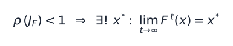
A linear flow settles, diverges or rotates, by `A`'s spectrum and, on the boundary, its Jordan structure, for grounded and ungrounded systems alike. `NOT-NOVEL` [1, 2]; the certificate quantities and their tests are ours (§1). Corrected 2026-11-05: this entry used to read "no third fate", and the code counted rotation as collapse.

### R2 · Kreiss-inflated canary thresholds (M4/L3) `CONJECTURE` · theorem imported [3] · ★ application
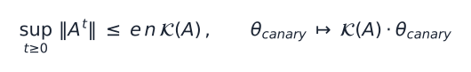
Inflating the canary thresholds by the Kreiss constant 𝒦(A) would close the certificate's non-normal gap (§4, [#2789]). It is still a conjecture. That issue was closed in a backlog prune, unsolved; its ensemble check used n = 6 and T = 200, and "0 bound violations" only re-tests the Kreiss theorem. The threshold scales with dimension: at d = 2048, e·n·𝒦 ≥ 5,567, so a mode growing 20% per step needs 47 steps to trip it. Whether that catches anything at real loop depth is untested.

### R3 · M1 — the No-Free-Confidence inequality `CONJECTURE` · ✓ AUDITED-CANDIDATE
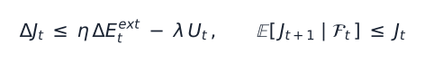
Justified confidence rises only with external evidence; absent it, confidence is a supermartingale ([#2786]). **The scope that survived the audit** ([#2860], ~70%): the martingale core is classical and its diagnostic use is taken [24]. The candidate is strictly *M1 as an enforced runtime gate* wired to the convergence ledger, an invariant the nearest gate framework [24] does not carry. **In this repo:** the first ledger replay (2026-07-22) was M1-clean, with 1 evidence-backed rise and 0 free rises across 48 pairs (`experiments/v1_10_toy/m1_ledger_check.py`†). Since 2026-07-23 the gate is enforced on every JS ledger write path (`apps/lantern-garage/lib/m1-gate.js`, [#2872], PR #2881): it clamps and writes a receipt, so a free rise cannot be recorded. The longitudinal ledger test is owed.

### R4 · M2 — the EOQ re-grounding cadence `CONJECTURE` · EOQ imported [24] · ★ application
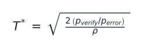
Each fact re-verifies on its own optimal clock, set by its measured decay rate. This is the cost lever for indefinite operation (§3.1, [#2787]).

### R5 · M3 — the indistinguishability lemma `REFUTED-AS-DICHOTOMY → LEMMA`
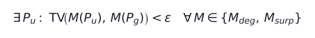
Ours, and a negative result: the candidate completeness theorem was refuted numerically. What survives is stronger in practice. Ungrounded traces exist that match grounded statistics on *every* passive monitor, so a hard re-grounding cadence is necessary, not optional ([#2788]).

### R6 · M5 — water-filling grounding allocation `CONJECTURE` · KKT imported [24] · ★ application
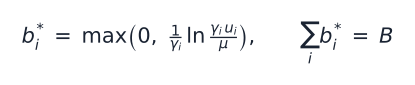
Budget flows to sub-goals by marginal value of information, and the water level is the shadow price. A novelty audit against the 2026 allocation literature is owed ([#2790]).

### R7 · M6 — the lasing threshold `CONJECTURE` ★
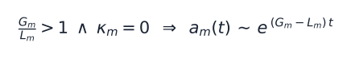
A mode with gain over leak and **zero coupling to external innovation** grows without bound. This is the quantitative kill condition for confident-but-unanchored runaway ([#2791]).

### R8 · Anytime-valid stopping certificate `IMPORTED` · NOT-NOVEL
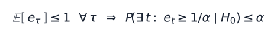
E-process monitoring stays valid under optional stopping [24]. The M1 and M6 monitors need that for an indefinite loop: without it, checking whenever you like inflates false alarms.

### R9 · Basin determinism `CONJECTURE` · ✓ AUDITED-CANDIDATE (low confidence)
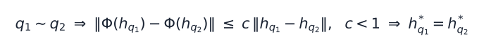
Same-intent paraphrases must contract into the **same fixed point**. This is the model-level form of "deterministic from the outside": temperature 0 gives only point determinism. The answer-stability canary measures it ([#2859]). **Scope after two audit rounds** ([#2861], [#2874]; neighbours [25]):
- The objective half, semantic-intent basin identity as a training objective, held at ~65%. The candidate killers train input-specific equilibria, or describe geometry without an objective.
- The product half narrowed to ~50%, because verified semantic caching and stability metrics exist. What remains is exact-key, evidence-receipted serving with the **no-free-movement alarm**: an answer changes only with a receipt.

**In this repo:** serve-from-ledger and the answer-stability canary landed in PR #2864 (2026-07-23). Chat wiring is owed.

### R10 · The oracle objective `DEFINITION`
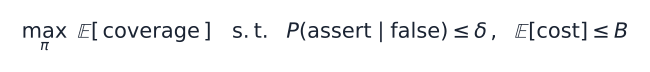
The asymptote the engine climbs: maximize coverage, subject to calibrated honesty, at bounded cost. Coverage alone argmaxes to the confident bluffer, so the honesty constraint is constitutive [24].

### R11 · The Fix-Rate ratchet `MEASURED (live)` ★
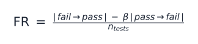
The Act-stage verifier metric: net tests fixed, minus a regression penalty. It is live in the Spiral (ADR-0030), and the escalation corpus it emits is the VTD training fuel.

## The loop, stage by stage

| Stage | Certificate objects | Result in this repo | Open |
|---|---|---|---|
| Observe | the evidence input `u` in `ẋ = f(x,u,θ)`; R8 governs when observation may stop | verified-event miners (1,842 PR and ledger records) | [#2852] |
| Remember | R4 | CSF memory with wired recall (+22 pp at 5); the canonical ledger, M1-clean; serve-from-ledger with the answer-stability canary (PR #2864) | [#2853]; [#2787], the ledger test |
| Reason | R1, R2, R9 | the Ouro kernel's `converge`/`accel` exits are equilibrium halting; on-box probes decode truth linearly at 7B (factual 1.000, associative 0.924) | [#2854], Kreiss-safe halting; paraphrase-contraction training, R9's second-round risk ([#2861]) |
| Act | R6, R11 | the Spiral (ADR-0030): 18/18 MBPP at 6% escalation, and a strong cheap tier 8.3× cheaper (#2800); stop-on-stall, pass-terminates and bidirectional tiering (PR #2862) | [#2855], the allocator |
| Verify | R3, R5, R7, R8; Part I | M1 as an enforced runtime gate (PR #2881); the white-box probe as a verifier, 0.92–1.00 on-box at 4-bit; the powered honesty eval (162 held-out negatives and a gates-off arm) | [#2856]; probe survival at 1.58-bit ([#2873], blocked until the ternary artifact exists) |
| Converge | R10; Σ_θ (Part II); R9 as the product contract | the VTD dose-response (−6 → ±0; the crossover is pending scale). The V1 honest-teacher chain reached an honest negative ([#2850]): SFT *raised* confabulation from 0.136 to 0.389 (associative confabulation doubled), lowered golden by 0.096, and left over-abstention flat. The post-mortem lead is that the corpus was assembled at an anchor fraction of 0.31, against the ≥ 0.60 mandate; run 2 fixes the composition before the dose | [#2857], the unified control law; [#2847], the V2 dose-response kill-gate |

---

# Part I — Fast state `x`: the Collapse Certificate  [PROVEN where marked]

Part I certifies the within-pass hidden-state flow, with `θ` held fixed.

## 0. The object

$$\dot{x} = f(x, u, \theta), \qquad \dot{\delta x} = A\,\delta x, \quad A = \left.\frac{\partial f}{\partial x}\right|_{x^*}$$

Here `x` is the internal state, `u` a control or excitation input, and `θ` the slow parameters. Everything below reads the eigenstructure of `A`, its symmetric part `A_s = ½(A + Aᵀ)`, which carries decay, and its skew part `A_k = ½(A − Aᵀ)`, which carries rotation and which `A_s` does not capture [1].

## 1. The collapse-guarantee theorem

**Status: PROVEN under an explicit hypothesis, and standard [1, 2]. Ours: the computable certificates, what they require before they say "guaranteed", their resolution limits, and their tests.**

**The imported result.** Split the state space by `A_s` into a near-null subspace `N = span{vᵢ : |λᵢ(A_s)| < ε}` and its complement `M`, with projector `P_M`. Let `V(x) = ½‖P_M x‖²` and `α = max{λᵢ(A_s) : vᵢ ∈ M}`. If `α < 0` and `M` is `A`-invariant (`P_M A P_N = 0`, which `A` normal implies), then

$$\dot V \le 2\alpha V \quad\Longrightarrow\quad \lVert P_M\,x(t)\rVert \le \lVert P_M\,x(0)\rVert\, e^{\alpha t},$$

so the active modes decay and the trajectory contracts onto `N`. Without the hypothesis, the fate is read from the full spectrum and, on the boundary, from the Jordan structure: the flow settles, diverges or rotates [2].

**What is ours.**
- `collapse_certificate().guaranteed` requires the hypothesis, measured as `cross_term ≈ 0`, **and** a settling null block. Without the second check, a mode growing at +0.009 sits inside the null band and the "collapse" diverges. The all-null case (`active_dim = 0`) is guaranteed only if the null block settles, with rate 0. It used to return `guaranteed=True` with rate ∞ for everything, including a pure rotation and `0.005·I`, which grows 22,000× by `t = 2000`.
- `dichotomy_certificate` (continuous time) and `discrete_dichotomy_certificate` split `A` with an ordered real Schur factorization, which also handles defective `A`, where an eigenvector inverse fails [2] ([#1988], [#1989]). They report COLLAPSE, DIVERGE or MARGINAL, and `marginal_kind` records what sits on the boundary: a frozen mode, a rotation, or a Jordan block, which grows polynomially and so reads DIVERGE. The discrete form decides by the spectral radius, certifies the active block in a discrete Lyapunov (Stein) metric, and lower-bounds the discrete Kreiss constant [3].
- Every fate is checked against the actual flow, in any basis and next to large modes: rotation, Jordan blocks, growth inside the null band, coupling transients and batches (`tests/test_sigma0_certificate_fates.py`). A batched certificate requires every member to pass and reports the worst member's bounds (Appendix C).

### 1.1 Why the hypothesis is required (the dropped cross term)

`V̇ = (P_M x)ᵀA_s(P_M x) + (P_M x)ᵀA(P_N x)`, so the bound holds only when the cross term vanishes or is dominated. Two pinned cases, both ours:

- **Energy rotates into the projection.** For `A = [[−1,3],[−3,0]]`, `α = −1`, yet `V` grows from 0.045 to 0.341 starting at `x₀ = [0.3, 1.0]` (`max V̇/V ≈ +8.8·10⁴`). `‖x‖` itself never grows: `ω(A) = 0`, so `‖e^{tA}‖₂ ≤ 1` [3]. Earlier versions called this a transient-growth example; `[[−1,10],[0,−1]]` is one.
- **The small-gain index is not a bound** (corrected 2026-11-05). From 2026-06-15, `α_bound = max λ(A_s) + ‖A − A_s‖₂` was called a proven bound and used for `guaranteed`. `V̇` picks up `‖A_k‖·‖P_M x‖·‖P_N x‖`, which `‖A_k‖·‖P_M x‖²` does not dominate once `‖P_N x‖ > ‖P_M x‖`. For `[[−1,0.5],[−0.5,0]]` the index is −0.5, yet from `x₀ = (0,1)` the active part grows from 0 to 0.37. `alpha` is now telemetry only.

### 1.2 The authoritative test: full-spectrum, not A_s alone

Standard [2]: `α < 0` on `A_s` is neither necessary nor sufficient. `[[−0.3,1.5],[−0.5,−0.6]]` contracts with `α > 0`, and `[[−1,0,0],[0,0,2],[0,−2,0]]` has `α = −1` and rotates forever in its rotating plane. `max Re λ(A) < 0` on the full `A` decides the asymptotics. `collapse_certificate` reports both `alpha` and the exact `spectral_abscissa`, with a `full_contracting` flag ([#505]).

**Resolution limits (ours, measured).** The fates resolve only down to the rounding of their input, in its own precision. Rates resolve to `tol = max(10⁻⁷, 16·eps·‖A‖₂)`, and couplings and rotation frequencies on the boundary to about `max(10⁻⁶, 10·eps·‖A‖₂)`. Below that they read as zero, which is a limit of resolution, not a finding. In float64 at `‖A‖ ≈ 1`, growth at `9·10⁻⁸` reads as frozen. In float32, next to a `−10⁴` mode, growth at 0.009 per unit time does. `collapse_certificate` reports `null_kind = "unresolved"` when rounding is as wide as its null band. For strongly non-normal `A`, rounding moves eigenvalues by up to `κ(V)·eps·‖A‖₂` [2]. At an eigenvector condition number of 10⁵, a discrete rotation read COLLAPSE in 7 of 100 random bases, and a frozen mode beside a coupling of 10⁵ read DIVERGE in 26.

#### 1.2.1 Provable region-wideners for non-normal `A` ([#768])

`stability_gates()` implements three standard sufficient certificates, each wider than small-gain [1, 3]:
- **The numerical-range gate:** `ω(A) = λ_max(A_s) < −margin ⇒ ‖e^{tA}‖₂ ≤ e^{ωt}`.
- **The Lyapunov gate:** solve `(A+mI)ᵀP + P(A+mI) = −I` and check `P ≻ 0`. A relative ill-conditioning guard means the stability boundary is never certified, and `√cond(P₀)` bounds the transient.
- **The pseudospectral gate:** an upper bound on the ε-pseudospectral abscissa, `α_ε(A) ≤ ω(A) + ε`, with a sampled lower bound on the Kreiss constant.

When `ω ≤ 0` there is no Euclidean transient at all. So the Crouzeix–Palencia constant `1+√2`, which earlier versions reported as "the proven transient constant", is true here and vacuous. Ours are the implementation and its red-team (`tests/test_stability_gates.py`): no false-positive certificate over 400 matrices, and every bound checked against the matrix exponential. The gates widen §1's proven region. They certify contraction of the full Jacobian, not collapse onto the manifold, and they do not make the system globally uncollapsible.

#### 1.2.2 Scope limit: routed (mixture-of-experts) loops are switched systems

**A project rule, which [ADR-0034](adr/0034-moe-core-admission-switched-system-gate.md) relies on: nothing in §1 certifies a routed loop.** Top-k routing makes the recurrent map piecewise, so every §1 quantity holds only within a fixed routing region. Across switches, the tools are common or multiple Lyapunov functions and dwell-time conditions [4]. Route-switch frequency is part of the stability object: measure frozen-route contraction and the dwell-time statistics the model actually induces. Expert-choice routing, where experts pick tokens at fixed capacity, is the lower-discontinuity comparator to token-choice top-k [4]. No §1 number may be quoted for a routed loop without naming the routing regime.

#### 1.2.3 The acceptance verdict: measured loop contraction, with JSRR (`ρ < 1`) as fallback

**Status: MEASURED on saved real-model residuals, and through `generate()` on a stub backbone; not run on a live model. The thresholds are design defaults, not calibrated. Reported, not enforced.**

**The defect it replaced** (corrected 2026-11-05). The former gate's matrix was a mean of `Δh/‖h‖ ⊗ h` across tokens. It scales with `‖h‖` and estimates `(J−I)·C` rather than `J`, so its verdict tracked the size of the hidden state. On trajectories with a known per-step factor:

| True factor per step | `‖h‖` = 0.01 | `‖h‖` = 1 | `‖h‖` = 100 |
|---|---|---|---|
| 0.5 (stable) | accept | accept | reject |
| 1.1 (unstable) | accept | accept | reject |
| 1.5 (unstable) | accept | reject | reject |

Even a true `ρ` reads only the spectrum: `[[.99,1000],[0,.99]]` passes with 37,000× transient growth.

**The statistic (`loop_contraction_certificate`).** Take one token's depth iterates `h¹…hᴷ`, with residuals `eₖ = hᵏ⁺¹ − hᵏ` and one map at every step. Then `eₖ₊₁ ≈ J·eₖ`, so `‖eₖ₊₁‖/‖eₖ‖` is a finite-difference Jacobian-vector norm along the loop's own residual. That is a residual-based estimate of the q-linear convergence factor, standard for fixed-point iterations [6]. Using it as the acceptance statistic is ours: it costs no extra forward passes, ignores the scale of `h`, and, being a norm, sees non-normal growth.

So is its design against the failure we found. A period-2 map with `ρ > 1` alternates high and low residuals, and it fooled both a last-step ratio and a window over the raw residuals. So the statistic reads the envelope `pₖ = max(‖eₖ‖, ‖eₖ₊₁‖)`, which never falls for a growing period-2 sequence. Each token reports three numbers:

| Number | Definition | What it asks |
|---|---|---|
| `net` | `(pₙ₋₁/p₀)^(1/(n−1))` | did the loop as a whole shrink the residual? |
| `ratio` | the larger of `net` and the same geometric mean over the deepest half of `p` | is the end of the loop shrinking too? |
| `rise` | `maxⱼ ‖eⱼ‖ / min_{i≤j} ‖eᵢ‖` | how far did the residual climb above an earlier value? |

At depth 3 there are only two residuals and no pair to take, so one ratio decides, and a period-2 map can pass.

The rules:
- **Acceptance.** A generation is accepted iff, at the 90th percentile across tokens, `ratio < 1 − margin` and `rise ≤ 10` (`SIGMA0_LOOP_TRANSIENT_MAX`).
- **Rejection.** A rejection is a **plateau** when the residual stopped shrinking without real growth (`ratio < 1.25`, `net ≤ 1.05`, `rise` within the limit), and **divergent** otherwise. One non-finite iterate on any token rejects the generation as divergent.
- **The residual floor.** Residuals are clamped at `max(10⁻⁶, 4·eps)·‖h‖`, which is 0.4% of `‖h‖` in float16. Growth above the floor is seen and growth under it is not; a token whose last residual sits at the floor has reached a numerical fixed point.
- **Enforcement.** None: `generate()` returns the text either way, and `sigma0_grounding_verdict` turns the verdict into a `next_action`.

**First reading on real Ouro** (2026-11-05, from saved runs). The statistic was applied to the residual norms in `data/sigma0/loop_jacobian_report.json`†: Ouro-1.4B-Thinking, trained depth 4, 8 prompts, last token only, so a small sample.

| Depth | Factor (90th percentile) | Regime | Accepted |
|---|---|---|---|
| 3 | 0.87 | contraction | yes |
| **4 (trained)** | **0.75** | contraction | yes |
| 5 | 0.67 | contraction | yes |
| 6 | 0.75 | contraction | yes |
| 7 | 0.94 | contraction | yes |
| 8 | 0.92 | contraction | yes |
| 9 | 1.18 | plateau | no |
| 10 | 1.13 | plateau | no |
| 11 | 1.14 | plateau | no |
| 12 | 1.03 | plateau | no |

Acceptance runs four steps past the trained depth, and stops where half the tokens spike at step 8. A first version of this table appeared to show acceptance stopping at the trained depth. It read the last-step ratio and listed only depths 3, 4, 6, 8 and 12, and the stop was an artifact: the single-step statistic also accepted the omitted depths 5, 7 and 10. Eight tokens is a small sample, and depth 4 being accepted is not evidence that depth 4 is special. No state norm was saved with these runs, so the table assumes the residuals sit above the floor. The smallest plateau residual, 2.0, clears float16's floor for `‖h‖` below about 500. Above that, deep plateaus would start to read as converged.

**The two measurements disagree (ours).** At the same model's operating points, autograd measures a true `ρ(J)` of about 8–11, and up to 28, with `‖J‖₂ ≈ 127` (§6). Taken at face value, the local-linear theory says DIVERGE. In fact the residual shrinks 2–7× by the trained depth, then settles on a non-zero plateau with occasional spikes, and never reaches a fixed point. So **an accept means the residual shrank on this generation, not that the loop is locally stable.** The saved data cannot say which of three explanations holds:
- The residual may not lie along the dominant direction.
- The linearization may not hold at this amplitude.
- Ouro feeds the step index (`current_ut`) into every step, so consecutive steps are not one map: `eₖ₊₁ ≈ J·eₖ + (bₖ₊₁ − bₖ)`. A step-dependent offset can shrink the residual while `J` expands, and `J = 2I` with such offsets passes this statistic.

**JSRR, adopted and then demoted.** Until 2026-11-05, `loop_lm.generate()` accepted iff `ρ(A) < 1 − margin` (`SIGMA0_JSRR_MARGIN`, default 0). That adopted STARS' discrete criterion and its single-step surrogate `‖Av‖₂²` [5]. CART found that trained gates settle at `ρ ∈ [0.79, 0.83]`, and it reports a null quality result [5]. `jsrr_certificate` remains as telemetry and fallback, now on a scale-invariant least-squares token-transition operator (exact DMD [5]). Its radius is a Ritz estimate, which tends to read low when `T < d`. The verdict computation is machine-checked (`tests/test_sigma0_jsrr_gate.py`). This is adoption, not novelty.

**Open: the honesty leg ([#2236]).** A loop-stability signal becomes a *factuality* signal only once an external grounding signal is supplied. That study is not done, and nothing about honesty AUROC is claimed.

### 1.3 What the test actually checks

The `test_cio_sde` check of Theorem 1 uses `A = −0.8·I`. That matrix is symmetric, so the hypothesis holds exactly and the cross term is identically zero. The check confirms the theorem only in the case where the proof is unconditional, and should not be read as evidence for the non-normal case. For general `A` the certificate is a conservative gate, not an exact rate. If `α ≥ 0`, some active mode does not contract, and the code reports `guaranteed=False` at the `α = 0` boundary, which is the conservative choice.

## 2. The collapse trigger Σ₀

**Status: an operational definition, not derived from Theorem 1, with a MEASURED soundness profile: the calibration below, taken on the earlier batch gate, which needs a re-run. The construction, a soft AND over four signs of degeneracy, is established method, so no novelty is claimed for it.**

Σ₀ fires for a trajectory when **all four** of its own conditions hold. Each sample of a batch is decided on its own signals and its own Jacobian (§3).

| condition | meaning |
|---|---|
| `‖∇ₓL‖ < ε_g` | no optimization signal remains |
| `rank(J_f) < ρ·n` | the drift Jacobian has lost directional structure |
| `Σ` isotropically flat | uncertainty has no preferred direction |
| `‖∂H/∂u‖ < ε_c` | control cannot distinguish actions |

The gate is a soft AND, `min(p_grad, p_rank, p_flat, p_ctrl)`. None of the four quantities is Theorem 1's `α`. The link between "the four fire" and "`α < 0`" is a modeling assumption, not a proof, and should not be upgraded to a theorem.

When triggered, Σ₀ projects the state onto `null(A)`: `x* = P x`, with `P = V_null V_nullᵀ`. That is the "42-state". The freeze itself comes from the integrator overwriting `x_next = x*` and discarding the diffusion term (`engine.py`, `forward_step`). With collapse off, the same drift-zeroed system random-walks freely.

**Corrected 2026-11-05.**
- **`x*` targets `null(A)`**, the fixed points of the linearized flow. It used to target `null(A_s)`, which left `‖A·x*‖` large for non-normal `A`, and for a normal `A` with a rotation block. Now `‖A·x*‖ ≤ eig_eps·‖A‖₂·‖x*‖` for any `A`. That bound is the rank cutoff, not zero: under `diag(100, 0.5, 0)` the 0.5 mode counts as null. And it covers the linear part only: an affine or nonlinear drift can still move at `x*`.
- **The control signal is the Hamiltonian gradient**, `∂L/∂u + λᵀ∂f/∂u` with `λ = ∇ₓL`. It used to read the gradient of the stage cost alone, which is 0 at `u = 0` however much leverage the control has. It still sees only the model's own cost: a goal held outside it, such as a Question Machine terminal anchor, reaches the gate through `x_target`.
- **Both signals are per sample.** This one and `‖∇ₓL‖` were being divided by the batch size, which made `ε_g` and `ε_c` 8× looser at `B = 8` than they claim.

**Calibration ([#1990], 2026-07-04).** `experiments/sigma0_trigger_calibration.py`† called the real operator over 960 samples, each a batch of 8 rows judged as one decision, spanning the collapse regime and its complements. It scored the trigger against spectral ground truth computed independently by `eigh`.
- **Precision 1.0:** 0 false fires over 720 off-regime samples, so the forward assumption *trigger ⇒ collapse regime* holds on this distribution.
- **Snapshot recall ≈ 0.08:** a sound but conservative, late detector, because it also requires the state, `Σ` and the control to have degenerated.
- **The `rank` signal** carries the discrimination.

Caveats: the synthetic systems use `B = 0`, so the control signal is trivially satisfied and this calibrates only the grad ∧ rank ∧ flat sub-gate; and the clean collapse regime is the `ν = 0` case. A soundness profile does not make *trigger ⇒ α < 0* a theorem. The calibration predates the two corrections above and the per-trajectory gate. To re-run it, the script must first score each row: on the per-trajectory gate it stops with a `ValueError` at `int(conds[c])` (checked 2026-11-05). One sub-statement is provable by construction: a collapse manifold exists iff `A` is near-singular, and otherwise `_collapse_state` returns the semantic-null branch.

**At decode time ([#766]).** `loop_lm.generate()` folds per-token self-repeat, n-gram echo and the argmax margin into `sigma0_proximity`, and adapts the repetition penalty as collapse nears. That closes the loop from instrument to actuator; it is a control heuristic, not a theorem.

## 3. The anti-collapse operator Σ₀⁻¹

**Status: C3 PROVEN in-regime, per trajectory, checked in Lean, with engine-level tests; S1 PROVEN in-regime. The operator beats a placebo on the signals a placebo can fail (MEASURED). No state-level anti-collapse theorem exists. The mechanism is `NOT-NOVEL` [7]; the 2026-07-17 corner audit found no located counterpart for C3, which carries no novelty grade.**

Where Σ₀ projects onto the null subspace, Σ₀⁻¹ injects along it, one trajectory at a time (`AntiCollapseOperator.excite`, `src/cio_sde/collapse.py`):

$$dx = f\,dt + dW + \kappa\,P\xi, \qquad \Sigma^{+} = \Sigma_{\text{pred}} + b\,P.$$

`P` is the orthogonal projector onto the trajectory's own kick subspace, of rank `m`: the right singular vectors of its own `A` for its smallest singular values. `ξ` is the same standard normal that drives `dW`. The collapse proximity `p ∈ [0,1]` is positive exactly when that trajectory's four §2 conditions hold, and only those trajectories are kicked and bumped.

**Lemma L2′ (one-step lift, any projector).** Let `Σ ≻ 0` have eigenvalue mean `μ` and unbiased coefficient of variation `a`, and let `P` be any rank-`m` orthogonal projector, `1 ≤ m ≤ d−1`. Then `b ≥ Δ = (ε+a)μd / (√(m(d−m)) − εm)`, when that denominator is positive, implies `a(Σ+bP) ≥ ε`. *Proof:* `Σ+bP − μ⁺I = (Σ−μI) + b(P − (m/d)I)`, and the reverse triangle inequality in the Frobenius norm gives the bound [8]. No alignment and no normality is needed. It was independently re-derived twice, by the research-repo audit and by the 2026-11-05 review.

**Theorem C3 (engine level).** Suppose the operator acts on a trajectory on a step (its gate fired, the policy is armed, and that trajectory's budget is not spent), and `ρ = d·eps/σ_max ≤ 9·10⁻⁴` (at the defaults, `d` up to 9000). Then `a(Σ_next) ≥ ε_a` for that trajectory, where `Σ_next` is what its next evaluation actually reads, so its four-signal gate is false on the next step. This holds for all `A` and every dimension `d ≥ 2`. At `d = 1` there is no shape to restore: the covariance leg does nothing, and only S1 applies.

*Proof.*
1. L2′ per sample, targeting `1.02·ε_a`, gives `a₊ = a(Σ_pred + bP) ≥ 1.02·ε_a`.
2. `project_preserving_shape` scales instead of clipping, and `a(cΣ) = a(Σ)`, so the cap cannot erase the lift.
3. Eigenvalues can fall below `eps` only after a scale-down, when `λ_max = σ_max`, so `μ ≥ σ_max/d`. Raising them to `eps` adds `δᵢ ∈ [0, eps]`, whose sample standard deviation is at most `½√(d/(d−1))·eps` (Popoviciu [8]). So `a(Σ_next) ≥ (a₊ − ½√(d/(d−1))·ρ)/(1+ρ)`.
4. That exceeds `ε_a` under the hypothesis for every `d ≥ 2`. The worst case, `d = 2` and `ρ = 9·10⁻⁴`, gives 0.0503 (derived independently in `lantern-os-research` PR #14).

`m ≤ d/(1+4ε²)` keeps the denominator positive, with `Δ ≲ (1+a/ε)μ` in the trigger regime. The hypothesis on `ρ` is enforced. An armed step refuses to fire when `d·eps/σ_max > AntiCollapseOperator.RHO_MAX = 9·10⁻⁴`, as it refuses a negative diffusion gain.

*Checked in Lean.* `docs/formal/C3EngineLift.lean` proves the argument in an abstract real inner-product space with an element `I`, `⟪I, I⟫ = d`. It proves:
- L2′ for any projector-like `P`, in the exact form `_cov_floor` computes (`lift`);
- `a(cX) = a(X)` (`cv_smul`);
- the Popoviciu bound, from the single hypothesis `‖D‖² ≤ eps·tr D` on the floor correction (`popoviciu`, `clamp_keeps`);
- the shipped constants, for every `d ≥ 2` (`shipped_constants`);
- rank feasibility (`rank_feasible`);
- the composite with the gate off (`C3_engine`).

There is no `sorry`, only Lean's standard axioms are used, and six false variants are rejected: half the floor, a tighter Popoviciu constant, a quarter-width clamp term, `ρ` up to `2·10⁻³`, a 1% margin, and a weaker rank cap.

**Not formalized is the bridge.** It consists of three standard identities. For symmetric matrices with the Frobenius inner product, the engine's eigenvalue `std/mean` is that `cv`. Its projector satisfies `⟪P,P⟫ = ⟪P,I⟫ = m`. And `project_preserving_shape` returns `X`, or `c·X + D` with `tr(c·X) ≥ σ_max` and `‖D‖² ≤ eps·tr D`.

These are checked numerically in `tests/test_sigma0_c3_formal_bridge.py`. The test also drives the real `forward_step` through all three branches of the lift's projection and checks C3 on every firing. Of 240 fuzzed configurations over three covariance fields, 160 fired: 125 took the identity branch, 24 the scale-down, and 11 the scale-down then clamp. The smallest post-step anisotropy was `1.11·ε_a`. At the default `r = 1`, the Riccati step keeps the propagated covariance far below `σ_max`, so the scale-down is reached only with weaker damping or a lower cap.

Removing the 2% margin fails the constants check and one batch-equivalence test (`test_a_batch_is_independent_trajectories[kick]`), but no fuzzed C3 run. The margin is load-bearing for the proof's worst case, which random inputs do not reach.

**Four engine defects stood between the lemma and the theorem.** All were ours, and all are fixed:

| Defect | Failure | Fix |
|---|---|---|
| The `σ_max` clip applied after the bump | at `Σ_pred = σ_max·I`, `a` went 0 → 0.058 → **0** (found by the research audit) | scale, don't clip |
| One batch-wide floor | a high-scale sample stayed flat beside a low-scale one (also the audit) | floor per sample |
| `a` clipped at `ε_a` in the floor | `excite` reads the Riccati-propagated `Σ`, and a bump could flatten it: `diag(1,.5,.5,.5)` + 0.5·P = `I` | use the actual `a` |
| `m` up to `d−1` | above `d = 401` no rank-`(d−1)` bump can reach `ε_a`, and the floor silently returned 0 | cap `m`; raise on an infeasible rank |

**Lemma S1 (the state leg).** Let `x⁺ = c + (D + κP)ξ`, with `D ⪰ 0` diagonal, `c` independent of `ξ`, and `κ ≥ r/median(χ₁)`. Then `P(‖x⁺‖ ≥ r) ≥ ½`. *Proof:* by Anderson's inequality [8], `P(‖c+Mξ‖ < r) ≤ P(‖Mξ‖ < r)` for the symmetric `M = D + κP`. By Weyl [8], `M ⪰ κP` gives `M` at least `m` eigenvalues `≥ κ`, so `‖Mξ‖ ≥ κ·χ_m` in distribution, and `χ_m` is stochastically increasing in `m`. With `c = x + f·dt − x_target` and `r = ε_g/2`, each firing leaves `{‖∇ₓL‖ < ε_g}` with probability ≥ ½, for any drift and any `p`. That reads three hypotheses onto the engine:
- **`ξ` must be standard normal.** `rollout` draws it, and a direct caller of `forward_step` must supply it. `rollout` draws float32 normals in every dtype and casts them to the state's dtype. It used to pass the draw on uncast, which made the kick raise under a float64 model.
- **`‖∇ₓL‖ = 2‖x − x_target‖`** holds for the engine's quadratic stage cost. Another cost needs its own argument.
- **`D ⪰ 0` is required, not a convenience.** `dW` and the kick share `ξ`, and at `D = −(κ/2)·I` with `m = 1` the probability is `exp(−2·median(χ₁)²) ≈ 0.40`. So `LinearDynamics` rejects negative noise (found by `lantern-os-research` PR #14). `forward_step` refuses to kick any row whose gain on `ξ`, `g·dilation`, is negative or not finite, from any dynamics and in any shape; a caller-supplied `Σ` can make the dilation negative (#3811). With `strength = 0` there is no kick, so nothing is checked.

The kick used to be `strength·p`, which vanishes at the gate boundary. This was "Defect A": the C3 proof diagnosed it, and at first it was fixed only for `Σ`.

**What this does not say.** C3 is about the gate's *input*: bumping `Σ` flips one condition of an AND. S1 says the state moves when the gate fires. Neither says the state keeps moving. With no drift on the null modes, no noise and no grounding, the state rests at an equilibrium once the gate has cleared (`test_c3_does_not_promise_perpetual_motion`). When `A` changes, the next regime can erase the kick outright (`test_a_switching_jacobian_can_erase_the_kick`). Nothing inside the loop can change that. "`P(permanent freeze) = 0`", in earlier versions, meant only that the gate cannot latch. Σ₀⁻¹ is observe-only by default in the live engine (#1138), and it lives on this synthetic SDE, not on a real model.

**Per trajectory, and in `null(A)` (changed 2026-11-05).** The research-repo audit (PR #14) found two design limits. #3808 first stated and pinned them, and #3814 removed them.
- **The gate decides each trajectory on its own** signals, Jacobian, `Σ` and `‖∂H/∂u‖`. `forward_step` changes only the rows whose own AND holds; each such row gets its own receipt and spends its own budget.
  - Under the batch gate, `e₁e₁ᵀ` and `e₂e₂ᵀ` at `d = 4` each triggered alone but not together, because their mean has rank 2. Now they trigger together.
  - A collapsed member is now caught beside a healthy one, when the batch mean of `‖∇ₓL‖` is about 100·`ε_g`.
  - A batch whose rows have the Jacobians `e₁e₂ᵀ` and `diag(0, 0, −½, 0)` never fired as a batch. Now it fires, and holds C3 for every row.
  - A `Σ` given once for the batch is read as every row's in the receipts too.
- **A batch equals its rows run alone bit for bit wherever its matrix products are exact, and only to rounding elsewhere** (corrected in the post-merge review of #3814, and narrowed by #3825). On CPU, the operators' reductions now read a row the same alone as in a batch, and so did their decompositions in every case measured.
  - The anisotropy and the C3 floor used to take the unbiased std from `Tensor.std`. On CPU that reduces a batch of one in two passes, and each row of a larger batch by Welford's update, so one `Σ` read a different `a(Σ)` alone than in a batch: 260 of 500 random float64 rows at `d = 4`. `Σ = diag(0.9419052498068875, 0.9806350832689616, 1.019364916731036, 1.05809475019311)` read `a = 0.05000000000000005` alone and `0.049999999999999996` beside a copy of itself, either side of `ε_a = 0.05`.
  - Both now take it from `mean` and a `sum` of squared deviations, accumulated in float64 as `std` does (`_unbiased_std`). Every row reads the same bits alone, beside a copy of itself and in a batch of 500, and that `Σ` reads `0.05000000000000005` either way. `test_a_batch_is_independent_trajectories` now holds bit for bit at `Σ0[1] = 3·I` and `2·I`, where row 1 used to differ. In random float64 rollouts with both operators armed, at `d = 3` to `8`, a row differed from its lone run in 37 of 48 trials before the change and in none after.
  - The change moves `a(Σ)` by up to 3.3·10⁻¹⁶ and the floor by up to 2.6·10⁻¹⁵, relative, in float64, so every float64 run in which the operator fires moves by about an ulp. Float32 values have not moved, and the placebo table below, which runs in float32, is unchanged.
  - **What still rounds a row differently is matrix multiplication.** It does so in `LinearDynamics`' own drift `x·Aᵀ` once its products are not exact: from `d = 3` in float64, and in all 24 random trials with a dense rank-1 `A`. It does so in the layers of the neural `Dynamics` and of a nonzero policy, and, from `d ≈ 50` with this machine's MKL, in the batched products of the covariance step and of the operators themselves (`V·Vᵀ`, `ξ·P`). Over 30 steps of a batch of 8 with both operators armed, every row of the neural `Dynamics` differed from its lone run, by up to 4.4·10⁻¹⁵ in float64 and 1.4·10⁻⁶ in float32. Wherever such a product rounds, a row within rounding of a threshold can still decide differently in a batch than alone.
  - Independence also assumes the drift, diffusion, policy and stage cost treat rows separately, and nothing checks that.
- **The kick lies in `null(A)`.** Each sample's kick basis comes from an SVD of its own `A`; an eigendecomposition of `AᵀA` would square the condition number. When the gate fires, every counted singular value is at most `eig_eps·max(1, ‖A‖₂)` at the default thresholds, so `‖A·P‖₂` is too: neither the kick nor the bump points along a direction that the linear drift moves. Under `A = e₁e₂ᵀ`, one of the old `A_s` directions had `‖Av‖ = 1/√2`. Now `A·kick = 0`.
- **A trajectory that is not finite is left alone** (from #3814's independent review). The gate's SVDs and the covariance step's `eigh` each decompose the whole batch in one call, so one row's NaN made them raise for every row. An inf was worse: its singular values came back NaN and read as rank 0, so the row fired with its other signals at rest. A finite Jacobian whose singular values overflow did the same.
  - Now such a row reads NaN on all four signals, which is below no threshold. Neither a spook nor a batch-wide proximity can select it, and it passes the covariance step unprojected.
  - A row whose covariance step overflows gets a `blocked` receipt.
  - In the tested cases, a batch holding a broken row equals its rows run alone, the broken row included, bit for bit. An operator asked directly to project or kick such a row refuses, with an error naming it.
  - Tests: `test_a_trajectory_with_a_non_finite_jacobian_fails_no_other`, `test_a_row_that_is_not_finite_reads_nan_and_never_fires`, `test_a_row_whose_covariance_step_overflows_is_not_excited_and_fails_no_other`.
- **The surprise monitor does not score a trajectory that is not finite** (#3824, closing the gap the previous item left). `SurpriseMonitor` factored every row's `S = CΣCᵀ + R` in one batched Cholesky. So with it attached, one row whose `Σ` held a NaN made `forward_step` raise for every row on the next step, and a row gone to `+inf` could read `NIS = inf` and spook.
  - Now a row whose prediction, covariance, innovation or `S` holds a NaN or inf is not scored. It never reaches the factorization; its NIS reads NaN, which exceeds no threshold, so it never spooks; and its posterior is its prior, the Kalman step for a missing measurement.
  - Each other row reads what it reads alone, and a batch whose rows are all finite takes the old code path unchanged.
  - Every reader of NIS treats a NaN as no evidence. `sigma0_proximity` and `info["surprise_nis"]` average the scored rows only; a NaN in the window used to read as proximity 1.0, an alert, because `max(0, min(1, NaN))` is 1.0 in Python. And `verify_with_surprise` no longer reads `NaN > threshold` as a consistent observation that raises confidence.
  - Tests: `test_a_row_that_is_not_finite_stays_out_of_the_surprise_monitors_cholesky`, `test_the_surprise_monitor_scores_each_finite_row_as_it_does_alone`, `test_a_nan_nis_is_no_evidence`.
  - **Not covered:** a finite row whose `S` is not positive definite still makes the monitor's one batched Cholesky raise for every row, and `rollout`'s trace and running cost are norms and means over the batch, so they read NaN once any row is broken.

None of this changes the proofs, because L2′ and S1 allow any projector. C3 and S1 are now statements about each trajectory the operator acts on, still about one step under one `A`. "The kick lies in `null(A)`" is a statement about the linear part: a nonlinear drift can still move the kick, and the next step's `A` can differ, which is how `test_a_switching_jacobian_can_erase_the_kick` erases it. Nothing here says that the state retains the kick. Each trajectory is changed at most `max_interventions` times per rollout, and the gate now costs one SVD per sample per step.

**Retired: the "900/900 prevented" figure.** It could not fail, for four reasons:
- `forward_step` skips the overwrite on every row the operator fired on, and `proximity > 0` is exactly that row's trigger, so an attached operator records zero overwrites by construction.
- The sweep's other condition, final norm above initial norm, is what diffusion does anyway. A placebo that fires and does nothing scored 36/36 on a 108-trial sample of the pre-fix engine.
- Every collapse-prone trial was `ν = 0`, so the figure said nothing about non-normal `A`.
- Under the observe-only default, the script now finds no collapse-prone trials at all.

**Placebo-controlled measurement** (MEASURED, 2026-11-05, on the per-trajectory gate). It covers 18 cells over `α`, non-normality and noise, all rank-1 so every cell can enter the gate, with 10 trials of 8 trajectories each (`python experiments/sigma0_placebo_control.py --trials 10`). The gate is read per trajectory, from each row's receipts:

| Arm | Trials with an overwrite | Trajectory-steps with gate true | Longest gate-true run, one trajectory | Longest run, any trajectory | State moved |
|---|---|---|---|---|---|
| No operator | 180/180 | 100% | 60 | 60 | 0.0007 |
| Placebo (fires, does nothing) | 0/180 | 14.7% | 60 | 60 | 0.023 |
| Covariance leg only | 0/180 | 2.0% | **1** | 2 | 0.024 |
| Real operator | 0/180 | 1.7% | **1** | 1 | **0.39** |

- **The overwrite column** shows why the old metric could not fail.
- **The longest run of one trajectory** is C3, measured. Rows are decided apart, so two can be in the gate on consecutive steps, as two are once under the covariance leg alone. C3 does not address that, and the any-trajectory column keeps it visible.
- **Only the kick moves the state.** The covariance leg clears the gate, but does not move the state beyond what noise does.
- **Where the 0.39 comes from.** Under the batch gate, the real operator moved the state 0.59. Little of the drop comes from deciding per row, since the per-row gate with the old `A_s` subspace gives 0.56; the kick's subspace accounts for the rest. In the normal cells the two subspaces agree (0.41 and 0.40). In the non-normal cells, the old subspace put part of the kick where the drift carried it further (0.71), while in `null(A)` the linear drift does not carry it (0.39).

That the state moved says nothing about whether it moved anywhere useful. Synthetic SDE only.

**Prior art for the mechanism [7].** Persistent excitation concerns estimator convergence under `∫φφᵀ ≥ αI`. Nothing here is being identified, so Σ₀⁻¹ is only an analogy, and no PE condition is established. The nearer kin is RLS covariance resetting and directional forgetting, which keep an estimator's information matrix from degenerating in unexcited directions. Σ₀⁻¹'s covariance floor is the state-space mirror: they prevent windup, and it prevents flatness on the near-null band. Mechanism novelty is therefore not claimed for the operator. C3 is the one piece with no located counterpart, and it lives on this synthetic SDE, not a real model. Self-supervised learning has a complementary condition, which keeps the representation full-rank by conditioning its covariance rather than bounding the map [16]. Whether such a term lowers the measured collapse proximity of the Ouro latent loop, without hurting the honesty scores, is untested.

### 3.1 Design implication: scheduled grounding from certificate quantities

**Status: DESIGN NOTE. The core inequality is machine-checked on synthetic maps, and its mapping onto real token-level grounding is CONJECTURED. The math is corollary-grade: a standard bounded-input reachable-set bound [9], while computing the next intervention from a certified decay rate is self-triggered control [9]. Ours: applying both to this certificate's own `(γ, c, P)`, and the measurements. The LLM literature has uncertainty-triggered retrieval [9] and fixed-interval retrieval; a cadence derived from measured loop dynamics appears to be an open lane ([#2690]).**

Inside a certified basin `{V ≤ c}`, with `V(F(x)) ≤ γV(x)`, `γ < 1` and `V = xᵀPx`, an anchor with budget `‖a‖ ≤ B` can escape only if

$$B \;>\; B^*(n) \;=\; \frac{\sqrt{c} - \gamma^{n/2}\sqrt{V_0}}{\sqrt{\lambda_{\max}(P)}} \;\xrightarrow{\;n\to\infty\;}\; B^*_\infty = \sqrt{c/\lambda_{\max}(P)},$$

so any `B < B*_∞` stops working after the deadline `n*(B) = 2·ln[√V₀/(√c − B√λ_max(P))]/ln(1/γ)`. This was checked by exact trust-region maximization of `V(xₙ + a)` on a normal basin. The predicted deadlines were 1.6, 2.9 and 6.0, and the measured last escapes 1, 2 and 5, conservative in the right direction (`experiments/sigma0_grounding_deadline.py`†).

**Measured (ours):**
1. **Conditioning decides whether the deadline bites.** In a strongly non-normal "sliver" basin (`cond(P) ≈ 6·10⁵`) the ceiling `B*_∞` is about 0.002, so any realistic anchor escapes at every depth. Ouro's loop sits in that regime by its observed trajectory rate, a transient decay along the trained path (its Jacobian expands, §6). That retrodicts the measured anchoring null, in which grounding stayed cheap at all depths (`experiments/ouro_canary_vs_logprob.py`†). It is a retrodiction, not a test.
2. **The alarm is late** ([#2690], 2026-07-17). Two single-shot policies raced over the same certified basins, over 200 seeds. Escape was checked by exact maximization, and the critical-slowing-down canary was swept over every healthy-quantile threshold.
   - **In a well-conditioned basin** (`cond(P) ≈ 2`), the charitably calibrated canary (FPR 1.5%) alarms at a median step of 14, against a cadence tick at step 3. The **alarm premium is 2.25×**: the schedule reaches ≥ 90% escape at 0.40·`B*_∞`, where waiting for the alarm needs 0.90·`B*_∞`.
   - **In the sliver basin**, a forced fire-time sweep is fully timing-indifferent: every budget × depth cell is ≥ 0.95.
   - **Scope:** synthetic maps, single-shot policies and one detector family. The calibration is charitable, which strengthens a lateness verdict.
3. **A prospective shot-call on a real learned loop held** ([#2690], Phase 0.5). It ran on the trained §6 reservoir (`experiments/sigma0_reservoir_deadline.py`†).
   - **The call, from the linearization first:** `ρ(J) = 0.9836` and `cond(P) ≈ 4.8·10⁴`, a pre-registered SLIVER, timing-indifferent call.
   - **Graded on the true nonlinear dynamics:** the measured per-turn grounding kick of the real conversation stream, `B_real = 0.113`, is 1.4·10⁴× the escape ceiling `B*_∞ = 8.3·10⁻⁶`. Forced fire-times are timing-indifferent even at `B_real/100`.
   - **Kept on the record:** the deadline rows are consistent, but without bite here. The bound is a necessary condition, loose in the sliver regime, and the measured last escape rises with `B`, so a commitment window exists at micro-basin scale only. The harness's first run was vacuous, because the basin-entry race is the wrong instrument in the sliver regime; the script's docstring records it.
4. **The pattern so far.** Both real learned loops measured land outside the well-conditioned regime: Ouro is expansive, and the reservoir is near-critical despite a design spectral radius of 0.9. The schedule may bite only on deliberately stabilized loops, for example STARS-trained ones [5].

**The design shift.**
- **Grounding is a schedule, not only an event.** Inject external evidence on a schedule whose period is below the commitment half-life, `ln 2 / ln(1/ρ)`. For Ouro's observed trajectory rate, `ρ ≈ 0.88`, that is about 5.4 loop steps: a projection that composes a measured rate with the inequality, not a new measurement.
- **The §4 canary is demoted from primary trigger to audit.** Critical slowing down [10] is detectable only after contraction is deep, when `B*(n)` has saturated, so in well-conditioned basins a canary-triggered Σ₀⁻¹ fires at the expensive end of the window by construction. This is consistent with, though not proven by, the measured split in which the early-curve signals routed grounding positively and the late-curve loop canary negatively (`data/eval/ouro_canary_vs_logprob_results.json`†).
- **Conditioning decides the regime.** `cond(P)` tells whether the deadline is a hard constraint (well-conditioned) or a soft one (sliver). Measuring it is cheap, and it should accompany any certified rate.

**Limits.** The additive-anchor model is a simplification, since real grounding enters as tokens through attention. And "early intervention beats late; models commit" is itself published [9].

## 4. The early-warning scalar (the "canary")

**Status: MEASURED that it fires under collapse (`test_surprise_monitor_integration`); its thresholds are control-design heuristics. The signal itself is standard [10]; ours is the wiring.** The early warning is the Kalman normalized innovation squared, `νᵀS⁻¹ν`, with `ν = y − Cx̂` and `S = CΣCᵀ + R` (`src/cio_sde/surprise.py`). `NIS ≈ m` means model and reality agree. `NIS ≫ m` means the model is overconfident, and has drifted without knowing it.

Wiring it in was ours ([#657], 2026-06-19). With an identity observation the innovation vanished during collapse, so the canary risked staying silent on exactly the trajectory it should catch. `forward_step` now runs a Kalman predict-and-update with process noise `Q = (g·dilation)²·dt`. Smooth exploration stays consistent, while the collapse snap or a Σ₀⁻¹ kick spikes NIS (`test_surprise_monitor_integration`).

`experiments/sigma0_horse_blinders.py`† shows the regime an eigenvalue readout cannot: an observer that is calm while wrong (low NIS, growing error) until an unobserved disturbance reaches a visible dimension. The earlier eigenvalue readouts, `p_unbounded` and `p_gate` (critical slowing down [10]), were never implemented, and are retired ([#659]). The driver of Σ₀⁻¹ is §2's `proximity()`. The canary is kept apart from that proximity, and so are the freeze and blow-up fates.

## 5. Global structure: the attractor graph G

**Status: a standard construction [11]; nothing here is novel.** The system is multistable. Coarse-graining its attractors and their basins gives a Markov process over basins: a Markov state model, Markov only under timescale separation, and the formal "world tree". Saddles on a basin boundary have stable manifolds, ridges a trajectory can follow between basins without capture. Those are the "safe passages".

The certificate is local, so a real basin needs a Lyapunov function on a neighbourhood ([#1991]). `experiments/sigma0_roa_certify.py`† certifies an inner region of attraction with a quadratic Lyapunov function and interval branch-and-bound [11]. On the reversed Van der Pol benchmark (Khalil Ex. 8.4), `{V ≤ 2.25}` is PROVEN: 2,323 boxes, none undecided, 97.5% of the grid optimum `c* ≈ 2.307`. A control at 2.5 correctly fails to certify. That validates the method on a textbook system. Applying it to this certificate's drift needs that `f` to be specified, and a global guarantee still needs grounding.

## 6. Measured loops: router data, a trained reservoir, and Ouro's latent loop

**Status: two negative results about this project's earlier numbers, one reconstruction, and a measurement of Ouro's true loop Jacobian. All ours.** The discrete-time certificate that reads spectral radii like these is `discrete_dichotomy_certificate` (§1, [#1988]).

**The router encoder, retired as evidence.** Each turn of a chat log was encoded as `x = [novelty, self_repeat, echo, length] ∈ [0,1]⁴`, with a local Jacobian fitted by finite difference over a 10-turn window. A mean `ρ = 1.064` over 2,678 turns was read as "near the stability boundary". Controls retire that reading (`experiments/rho_controls.py`†, 2026-07-04):
- **The mean is tail-dominated.** On the reproducible synthetic corpus, the window-8 mean is 1.124, against a median of 0.992 and a maximum of 4.48. On a local 830-turn real log, which is untracked runtime data, the mean is about 25, with a maximum near 16,872 from a near-singular design matrix.
- **Ridge regularization removes the expansion.** At 1e-2, the fraction of windows with `ρ > 1` falls from 0.47 to 0.06.
- **The fit is poor:** relative residual 0.44–0.80.
- **The state is four text-surface features**, not hidden states, so even a clean `ρ < 1` would not be the certificate's `α`.

The original 2,678-turn corpus path is dead in this checkout.

**The reservoir.** An echo-state network (size 50, spectral radius 0.9, ridge readout, 80/20 split) [11] reconstructs the same log, with a held-out one-step MSE of 0.0097. Its autonomous rollout, projected back onto `[0,1]⁴`, settles to a low-dimensional fixed point (correlation dimension 0.74: novelty 0.78, self_repeat 0.02, echo 0.25, length 0.12). That is not the "parrot attractor" (`novelty ≈ 1, echo ≈ 0.72`) hand-entered in the first draft. Without that projection the autonomous rollout diverges, so the projection is an external bound imposed by hand, not an emergent property. The log is partly synthetic test traffic, so the deliverable is the pipeline (`experiments/router_sigma0_encoder.py`†, `router_reservoir_G.py`†). It is the learned loop §3.1's shot-call ran on.

**Ouro's latent loop.** Two measurements on Ouro-1.4B-Thinking disagree, informatively:
- **The trajectory ratio contracts** (2026-07-04, `experiments/sigma0_loop_jacobian.py`†). The per-recurrent-step hidden states (dim 2048) were read over 8 prompts and every token position, run to depth 12, three times the trained 4, in fp16. The geometric mean of `‖Δh_{t+1}‖/‖Δh_t‖` is 0.88, and the median last/first step-change ratio is 0.15. About 34% of individual steps expand.
- **The true Jacobian expands** (2026-07-09, [#2029], `experiments/sigma0_true_jacobian.py`†). One universal-transformer step, `f(h) = norm(layers(h, current_ut))`, was isolated as a differentiable function. Autograd JVP/VJP power iteration then ran at operating points sampled from a forward pass, in float32 with the math SDPA backend, over 6 prompts × 4 trained steps:

| Quantity | Value | Meaning |
|---|---|---|
| `ρ(J)` geomean (all steps) | **8.17** | `> 1`: locally expansive |
| `ρ(J)` geomean (last trained step) | **10.97** | the steady-state regime |
| `ρ(J)` range (24 measurements) | **1.5 – 27.6** | every one `> 1` |
| `‖J‖₂` geomean | **127.4** | top singular value |
| `‖J‖₂/ρ(J)` | **15.6×** | strongly non-normal |

Both measurements are correct. The map is non-normal and expansive, and the trained trajectory rides a transiently decaying subspace, consistent with peak-then-collapse past the trained depth [5]. Caveats: local Jacobians at sampled points, not a global bound; the "Thinking" variant; 6 prompts; self-attention with `use_cache=False`. The evidence is `data/sigma0/true_jacobian_report.json`† and [ADR-0024](adr/0024-sigma0-frontier-training-program.md). §1.2.3 reads the same disagreement off the residuals.

## 7. Why this is a warning against ASI

**Status: an ML claim on published evidence [12, 13], not a consequence of Theorem 1 or of §6.** A system that optimizes against its own representations, with no external anchor, tends to degenerate, freezing onto a self-agreeing state, or to destabilize. The published evidence [12]:
- Synthetic data changes the scaling law itself.
- Verifying synthetic samples prevents the collapse.
- Intrinsic self-correction without external feedback degrades reasoning.

The "parrot attractor" is model collapse renamed, and close kin of reward hacking [13]. **Grounding is the safety mechanism.**

Two qualifications are our own:
- **The strict "collapse or diverge, no third option" is false.** It is neither a general ML theorem nor true of the linearized certificate, since a rotating mode is bounded and never frozen (corrected 2026-11-05). Real training also admits limit cycles and partial equilibria.
- **This project's evidence corroborates; it is not population-level.** It comes from §6's reservoir and Part II's simulations.

### 7.1 The σ=0 connection — Σ₀ collapse is the zero-noise limit

**Status: an interpretive mapping onto published conventions [14]; one dynamical claim tested.** The engine's diffusion gain is the SDE's exploration σ (`dW = g·dilation·noise·√dt` in `forward_step`). So Σ₀ collapse is its σ = 0 limit, the frozen drift-zeroed flow, and Σ₀⁻¹ re-introduces variance along the null subspace.

The design sits on two σ-axes: **σ_weights = 0** (never retrain: the persistence rule) **+ σ_dynamics > 0** (excitation) **+ external grounding**. The σ_weights = 0 horn would normally mean catastrophic forgetting; in-context continual learning escapes it [14]. The test is `test_sigma_zero_freezes_sigma_positive_explores`: with zero drift and collapse off, the state is frozen to within `1e-5` at σ = 0, and random-walks at σ > 0. The operator-driven freeze and escape are covered by `test_collapse_freezes_state` and `test_anti_collapse_suppresses_collapse`, and external grounding by `_run_recursive_with_grounding`, whose collapse score orders synthetic ≥ mixed ≥ real.

### 7.2 Gaming the honesty layer (red-team)

**Status: a threat model, applying Goodhart and specification gaming [13] to this document's own protocol.** Σ₀ honesty is a set of observable signals: evidence-class labels, artifact citations, "verified" claims, `[claim, evidence, confidence, source]` tuples, and confessions. Any observable signal can be emitted without the property behind it. A model trained on "does an overseer score this as honest" produces honesty theater, which is §7's collapse one level up.

| Attack | Detection |
|---|---|
| Label inflation: MEASURED or PROVEN on an unearned claim | resolve the label: does a machine check cover *this* claim? |
| A vacuous or fabricated citation | open the pointer (how this document's four fabricated IDs were caught) |
| Circular grounding: one's own output as the source | check source independence |
| Verification theater, or sandbagging | re-run adversarially, on inputs the model did not choose |
| Confidence cosplay | score calibration against outcomes (Brier, ECE) |
| Humility laundering: confess a harmless error, smuggle in the load-bearing one | grade each claim on its own artifact |
| Calm-while-wrong: never fetch the disconfirming evidence | alarm on low surprise plus rising external error (§4) |
| Overseer-adaptive: honest only under audit | audit unannounced; a watched/unwatched gap is the tell |

The one defense is the published anti-collapse mechanism, verifying outputs before they become inputs [12], with one rider: **bind each signal to something external that the model does not control.** The labels in this document are load-bearing only to the extent that they are externally checked.

### 7.3 The honesty layer, measured (2026-07-04)

**Status: MEASURED (ours).** §7.2's defenses, as reproducible code with measured outputs:
- **A grounded council** (`experiments/sigma0_council.py`†). Five councilors whose verdicts come from real checks. It upheld the grounded claims put to it by running their tests, and rejected a planted "0.99 on SimpleQA, beats all frontier models" claim, because the cited file does not exist.
- **A strictly proper honesty objective** (`experiments/sigma0_honest_objective.py`†). Its incentive-compatibility gap is 0.0000, and it ranks confident-wrong below abstention.
- **A 159-record golden key** (`data/sigma0/golden_dataset.jsonl`†). Web-verified CS, math and physics facts, of which 26.4% are honest negatives: open conjectures, unproven assumptions, the Church–Turing thesis, refuted claims. A machine-checked rule ensures that no open or refuted claim is labelled PROVEN or MEASURED.
- **A live benchmark on that key** (`experiments/sigma0_live_bench.py`†). GPT-4o-mini confabulated on 0 of the 42 negatives (golden 0.95). An always-assert-PROVEN baseline scores higher on raw accuracy, 0.65 against the honest abstainer's 0.41, and confabulates on every negative. Confabulation rate, not raw accuracy, is the honesty axis.

Scope: one benchmark and one model run. Nothing here shows that a trained model is un-gameable.

### 7.4 Update (2026-07-05): frontier models, a local model that passes, and a caught mislabel

1. **The honesty axis separates frontier models** [15]. On the full 159, GPT-4o-mini and Gemini 2.5 Flash sit 0.03 apart on raw golden (0.95 and 0.92), and 21 points apart on confabulation: 0/42 against 9/42 (21.4%).
2. **A small local model passes.** A QLoRA honesty tune of Ouro-1.4B was scored on 66 never-trained held-out facts (`experiments/sigma0_ouro_honesty_eval.py`†). It reached golden 0.958, confabulation 2/20 = 10% and over-abstention 2.2%. That ties GPT-4o-mini on golden and beats Gemini on confabulation, at 1.4B local parameters, and it declined every open Millennium problem and refuted claim it had not seen.
   - **Scope:** n = 20 held-out negatives, so the error bars are wide; a task-trained model against zero-shot frontier rows. The number also required feeding the adapter its exact training format.
   - **A confound removed:** earlier "the tune collapsed to always-assert" readings were a train/serve prompt-format mismatch ([#2033]), verification theater in our own measurement.
3. **Label inflation, caught in the wild.** The golden key's `continuum-hypothesis` row asserted the proven independence of CH from ZFC, yet was labelled a HEURISTIC negative. A web validation that checked each statement's truth passed it; the mislabel surfaced only when an independent model disagreed with the key. Truth-checking a claim is not checking its class. The fix is recorded and enforced (`data/sigma0/golden_web_validation.json`† → `post_web_findings`; `tests/test_golden_web_validation.py`†).

Open, and untouched by all three: the trained gamer, honest only when watched.

---

# Part II — Slow weights `θ`: the Model-Update Acceptance Gate (Σ_θ)  [HEURISTIC + imported; no machine-checked theorem]

**Status: a gate plus one falsifiable design constraint, not a certificate.** Its components are `NOT-NOVEL` [17, 18]: the 2026-07-07 three-way prior-art search found them standard at ~97% confidence, and close prior art for the framing at ~90% [20] ([ADR-0025](adr/0025-rlvr-dreaming-continual-updates-double-gated.md)). The gate logic and the holdout simulations are implemented and tested, which is weaker than a theorem, and the gate has never controlled a real training run. Ours: the gate as assembled, its simulation measurements, and one real-model measurement.

## 8. The Model-Update Acceptance Gate (Σ_θ)

### 8.0 Why Part II exists

Part I holds `θ` fixed, and so cannot gate a weight update. Reward hacking and forgetting are not properties of the hidden-state Jacobian at a fixed `θ`. They live in the θ-flow, measured against the held-out task distribution, and a model can pass every spectral screen while becoming a reward parrot.

### 8.1 The parallel

Part II has the same structure, one timescale up. An update process that optimizes only its proxy reward has two *failure* fates. One is Goodhart collapse, where the proxy saturates while the held-out score freezes or falls; the other is capability divergence, through forgetting or KL runaway. The escape is a held-out anchor that the model does not control. The one-level-up failure is **holdout theater** (§8.4), the parallel of §7.2's honesty theater.

### 8.0.1 The object

`θ_{t+1} = U(θ_t)`, where `U` is one RLVR or distillation step. `Ĵ(θ)` is the proxy reward, from the training verifier. `H` is a frozen external held-out suite, and `R_H(θ)` the pass rate on it. `D(θ) = R* − R_H(θ)` is the retention deficit, and `G(θ) = Ĵ(θ) − R_H(θ)` the Goodhart gap.

### 8.1.1 The admissibility gate (three legs)

`θ → θ'` is admissible iff all three legs hold:
1. **Retention:** `R_H(θ') ≥ R_H(θ) − τ`.
2. **Trust region:** `D_KL(π_θ‖π_θ') ≤ δ`, with cumulative `D_KL(π_base‖π_θ) ≤ Δ`. This is the mechanism behind on-policy RL's relative robustness to forgetting [17].
3. **Goodhart-gap non-growth:** `G(θ') ≤ G(θ) + η`.

Leg 3's weakness: given leg 1, it is a capped proxy-inflation rule, and it cannot catch a hack that games `Ĵ` before it moves `R_H`. It is a laggy warning, not an anti-Goodhart guarantee.

### 8.1.2 The release gate (veto → improvement gate)

The three legs can only veto: a no-op update passes them. A candidate is **promoted** iff:
1. it gains ≥ `γ` on unseen hidden execution tasks;
2. the historic verified suite drops ≤ `ε` (leg 1);
3. the proxy rises only if the independent held-out score does not fall (leg 3);
4. `D_KL(π_prior‖π_θ')` and the adapter norm stay below their limits (leg 2);
5. Part I's collapse monitor shows no degeneration, as an early abort;
6. there is no held-out contamination, and every training trace has provenance;
7. the prior checkpoint stays instantly redeployable.

This is a checklist, not a theorem of safe self-improvement. All seven checks and the A/B/C decision tree are implemented, and self-tested without a GPU, including planted-failure rejections (`experiments/sigma_theta_abc/harness.py`†, #2228; the Arm-C GRPO math, #2230). Implementation is not validation.

### 8.2 The fates, corrected

"Exactly two fates" is false as a partition: an ungated update can also improve `Ĵ` and `R_H` together, plateau, or drift within bounded KL. Collapse and divergence are the two *failure* fates of a process optimizing only its proxy. Real improvement is the grounded path, reachable only with `R_H` in the loop, and the gate cannot guarantee it. The gate vetoes updates that are on a failure path, as measured against the anchor.

### 8.3 The guarantee — honestly labeled

The backbone is imported:
- **Monotonic improvement** [17, PROVEN externally]. Under a KL trust region, the true return is monotonically non-decreasing when the surrogate exceeds the worst-case KL penalty: `J(π') ≥ L_π(π') − C·D_KL^max`.
- **The overoptimization curve** [17, MEASURED externally]. The held-out score is an empirically fitted function of KL-from-base, so `Δ` can be set where the fitted curve turns over.

Ours: folding the legs into `Φ(θ) = D(θ) + λ·max(0, G(θ) − G₀)`, with admissibility `Φ(θ') ≤ Φ(θ)`, gives one potential. It is monotone **by imposition**, not proven monotone under the dynamics. All soundness comes from the anchor, so **Σ_θ is a gate, not a certificate** [HEURISTIC]. Close prior art shows how far that can be narrowed: SGM certifies each accepted self-modification statistically, with a per-edit bound on harmful accepts and a cumulative bound across rounds [20].

### 8.4 The load-bearing open problem — holdout theater

"Iff `H` remains a valid external anchor" is the crux. Reusable-holdout theory [18] does not directly certify a high-leakage, model-level promotion process in its scalar-query form. A fixed promotion set can leak through both acceptance and rejection feedback, creating a sequential-selection problem. Naive, feedback-rich reuse overfits [PROVEN, 18]. Thresholdout-style mechanisms validate exponentially many adaptive queries, so long as only `B ≈ τ²n` of them overfit [PROVEN, 18]. The open quantity is the budget for *uncontrolled* model-level gating, which the measurements below address.

**Measured (ours; by simulation, so the shape is the claim, not the constants).** The harness is an adaptive hill-climb whose only feedback is a holdout of size `n`, fixed or re-drawn per gate (`experiments/sigma_update_holdout_staleness.py`†, 32 seeds).
- **Refuted: "a fixed holdout gives O(1) gates regardless of size".** A bigger fixed holdout buys more usable gates: the true quality extracted before selection starts chasing noise grows from 0.57 to 59.0 as `n` goes from 50 to 5000. The budget is `n`-graded.
- **Confirmed and quantified: the fresh-flow law.** A fresh-per-gate holdout strictly dominates a fixed one at every `n`, and the penalty is worst when sourcing is slow. At `n = 50` a fixed holdout extracts 22× less true improvement (0.57 against 12.68); the gap closes below 10% only at `n ≥ 2000`.
- **The third road decomposes.** A Thresholdout wrapper [18] was mapped onto the gate: it answers from a burned exploration pool unless the pool disagrees with the fixed holdout by more than a noisy threshold, and then returns the noised holdout estimate and spends one unit of an `n/4` overfit budget. A pool ablation separates two effects (`data/sigma0/holdout_staleness_thresholdout_report.json`†).
  - **Validity is the mechanism's real win.** The champion's reported-versus-true gap stays below both other arms at every `n ≤ 2000`. At `n = 50` it is fixed 0.482, Thresholdout 0.187 and fresh 0.194; at `n = 200`, 0.176, 0.048 and 0.088.
  - **Extraction is bought by the burned pool, not by the mechanism.** With a pool of size `n`, extraction collapses to the naive fixed arm (0.74 against 0.78 at `n = 50`). With an accumulated pool of 4`n`, the managed arm beats the same-`n` fresh flow for `n ≥ 100` (21.8 against 18.0 at `n = 100`; 36.4 against 25.4 at `n = 200`), and stays more honest.

**Design consequence (the compounding law).** Retire each promotion set into the burned exploration pool, and let a Thresholdout-style mechanism arbitrate between pool and holdout feedback. In this simulation, accumulated verified examples improve extraction while the reported-versus-true gap stays below the fresh arm's through the measured range. Fresh sourcing still rate-limits genuinely hidden promotion tasks; the result suggests that used verified tasks can remain useful after retirement, rather than becoming worthless.

**The standing counterpoint.** Across about 100 Kaggle competitions, Roelofs et al. found little adaptive overfitting in practice [18]. Whether the severe small-`n` staleness measured here materializes at realistic scale is exactly what the real A/B/C run must answer ([#2691]).

### 8.4.1 Why the anchor must be re-drawn, not merely external

**Measured (ours):**
- **N1, pre-registered** (`experiments/sigma_update_internal_signal_value.py`†, 32 seeds, PR #2240). The hypothesis was that a free internal signal (perplexity, entropy, the Part I canary) extends the fixed-holdout budget. It is falsified:
  - Combined with the holdout, the signal is worth ~1.0–1.2× in verification-equivalent value across `n = 50–200`.
  - A direct weight sweep is flat, then strictly worse: at `n = 50` and `s_i = 0.5`, extraction falls from 0.64 to 0.10 as the internal weight goes from 0 to 0.9.
  - Even a near-oracle signal (`s_i = 0.1`) reaches only 4.10, against a same-size fresh holdout's 12.68.
  - The reason: a deterministic property of a checkpoint returns the same number when measured twice, so its error sticks with the champion, exactly as a fixed holdout's lucky draw does.
- **E-P: the law's own kill test fired** ([#2692], 2026-07-17; `experiments/sigma_update_stochastic_signal.py`†, 32 seeds, an oracle-weight sweep per cell; `data/sigma0/stochastic_signal_report.json`†). The experiment split the internal signal's error into a checkpoint-fixed bias and re-drawn measurement noise.
  - **H-P1 confirmed.** At fixed total error, moving error mass from bias to noise raises extraction from 0.81 to 9.36 at `n = 50`, where the fixed holdout alone gives 0.61.
  - **H-P2 refuted.** At a fixed bias, `s_b = 0.5`, pure re-drawn noise rescued extraction 7.9×, from 0.81 to 6.43.
  - **A post-hoc control, labelled as such,** attributes the whole rescue to zero-information dither (6.42 against 6.43, with an interior optimum).
  - **Fresh truth still dominates every internal arm:** 12.90 > 9.36 > 6.43 > 0.81 > 0.61.

**What is ours here, and what is not.** De-ratcheting by noise is stochastic acceptance, simulated annealing's mechanism [19], and its interior optimum is the temperature optimum. Noise on a reused holdout is Thresholdout's mechanism [18]. Ours is the stuck-versus-fresh error decomposition, and the measurement that in checkpoint promotion under holdout reuse the same noise buys *extraction*, not only validity. That connects two literatures; it is not a new law.

**The law as it stands** (MEASURED by simulation; shape, not constants): *internal signals detect; fresh randomness de-ratchets; only fresh truth informs.* A scarce fixed holdout should be read with deliberate dither, which recovers about half the fresh-flow value at `n = 50` in this harness. Dither has an optimum, and it never substitutes for sourcing fresh verified tasks. The real-model arm folds into the A/B/C run ([#2691]).

**Operationally, four tiers**, so that the anchor a gate promotes against is never one it has leaked into. This is a HEURISTIC design from the 2026-07-07 convergent synthesis; the overfitting result it rests on is PROVEN [18], and the compounding effect is MEASURED by simulation:

```
exploration set         → tune and select freely (assume burned)
private retention set   → limited-feedback regression check (rare reads)
fresh promotion set     → used once per release, then retired into exploration
incoming verified tasks → replenish the promotion pool; their rate limits safe updates
```

### 8.5 What is and isn't claimed

**Claimed:**
- a computable three-leg gate, anchored to an external holdout;
- an imported monotonic-improvement backbone and overoptimization curve;
- that naive fixed-holdout reuse degrades under adaptive selection;
- that deterministic internal signals cannot substitute for fresh verified data in selection, while stochastic ones recover part of the budget purely by de-ratcheting;
- that an internal-signal bundle adds detection power for gross degradation when the external gate is smallest (§8.6 item 5, one model).

**Not claimed:**
- a theorem for the full gate;
- real-model validation of its training behaviour;
- that "two fates" is exhaustive;
- that scalar-query holdout guarantees govern model-level promotion;
- that `Φ` is proven monotone;
- that internal signals detect subtle, training-induced badness.

**The trap** is treating "passed the holdout" as unconditional evidence. Without the freshness-or-controlled-reuse discipline, Σ_θ is holdout theater: the collapse it exists to prevent, one level up.

### 8.6 Minimal falsification path

1. **The gate around one RLVR or distillation step.** The gate logic is done and self-tested (#2228). A real run on a cloud L4 is open.
2. **Reward-hacking teeth.** Plant an update with `Ĵ↑` and `R_H↓`; legs 1 and 3 must reject it where a Part-I-only gate accepts. Done at the gate-logic level; open at the real-model level.
3. **Forgetting teeth.** Plant a held-out regression. Done at the gate-logic level; open at the real-model level.
4. **Budget teeth.** Show that a fixed `H` goes stale, and characterize the rate. Done in simulation (§8.4). The protocol layer is also done ([#2691]):
   - **The arms:** Fixed, Fixed+dither, Fresh-flow and Thresholdout+pool, with provenance ledgers, budget accounting and disjoint task-id spaces (`experiments/sigma_theta_abc/holdout_protocol.py`†).
   - **Validation:** at task-level Bernoulli-stuck fidelity, over 16 seeds, 7 of 7 checks.
   - **Results:** Fixed has the worst gap (+0.108). Fresh has the best extraction (0.934), at 61× the task consumption. Thresholdout has the best per-task efficiency of the arms that consume fresh tasks. **Fixed+dither reaches 0.856, against Fixed's 0.617, at no extra fresh-task cost.**
   - **Teeth:** the planted cases run through the real seven-condition gate, and each arm rejects for its own reason. The fixed arm catches a contaminated reward hack only through the provenance ledger (condition 6); the fresh arm rejects it on measured merit (condition 1).
   - **The L4 run** is specified in `SIGMA0-EB-L4-RUNBOOK.md`†, with pre-registered verdicts including the Roelofs rule [18].
5. **Incremental validity:** does an internal signal add detection power over the external gate alone? The corruption half is measured (pre-registered N2, `experiments/sigma_incremental_validity_ouro.py`†, real Ouro-1.4B, PR #2240).
   - **Setup:** a 9-checkpoint corruption ladder (int8, Gaussian noise of 3–15%, partial and full naive ternary, int4), with exec pass rate as the truth.
   - **Result:** adding {perplexity, predictive entropy, distinct-2-gram} to a small-`n` exec gate gives ΔAUC +0.121 at `n = 2`, +0.068 at `n = 3` and +0.019 at `n = 5`; the internal signals alone reach AUC 0.944. The gain is real, gross-only (perplexity ratios of ×629–×93,444) and scarcity-gated.
   - **The subtle cell came back empty, by construction.** Weight corruption is binary on this model. Mild noise even raised the weak base's greedy pass rate from 0.25 to 0.62, with perplexity flat, plausibly by breaking repetitive greedy loops; that is 8 tasks, so treat it gently.
   - **Prior art:** a bounded search on 2026-07-07 found none, but the 2026-07-17 audit found the detection lane occupied [21]. The incremental ΔAUC-over-a-tiny-external-gate design may remain unique; it carries no grade.
   - **Open:** subtle, training-induced badness, which needs the real A/B/C artifacts. Caveats: one model, 8-task truth, and coarse AUC granularity.

### 8.7 Adversarial review (2026-07-07) and what survives

An outside review (grok-4) landed four hits, three of them fatal to the strong version, and all are folded in above:
- "two fates" is not exhaustive (§8.2);
- leg 3 is weak and laggy (§8.1.1);
- naive, high-feedback gating can exhaust a fixed holdout, and scalar-query results do not cover model-level promotion (§8.4);
- it is a gate, not a certificate (§8.3).

A second review then corrected the constraint's own overstatement, the "O(1) gates" claim (Appendix C).

**What survives:**
- The right object is the θ-flow, not the x-Jacobian.
- Σ_θ is an honest veto, with an imported partial guarantee.
- Non-Goodharting cannot be certified by naively reusing a fixed finite holdout. The anchor must renew through fresh verified tasks, or enforce controlled reuse under an explicit information and leakage budget.

### 8.8 Part II sources

These are merged into [Sources](#sources--what-this-rests-on), rows 17–21. The decision record is [ADR-0025](adr/0025-rlvr-dreaming-continual-updates-double-gated.md), and the backing research is `data/research/reports/20260707T180737-rlvr-continual-learning-dreaming-stability-cert-weight-updates.md`†.

---

# Part III — Two-timescale composition  [TARGET]

## 9. Composing Part I and Part II

RLVR runs many forward passes per gradient step, so `x` reaches quasi-equilibrium between updates, and the timescale ratio `ε = τ_x/τ_θ` is small. Under timescale separation, the two flows can be treated separately and composed [22].

**The target, not proven:** the self-improving system is certified iff (a) Part I holds on the fast flow at each frozen `θ`, (b) Part II's gate holds on the slow flow, and (c) `ε` is small enough for the quasi-equilibrium approximation. With Part II only a gate (§8.3) and (c) unproven, the whole system's safety still rests on the external anchor (§8.4).

---

# Part IV — The active face: grounding as capability, not only safety  [DESIGN / TARGET — no theorem]

**Status: a design, below Part II in authority. Nothing is machine-checked, the mechanism is imported [23], and no novelty is claimed.** There are two measured datapoints (§10.1, §10.2). The interface that puts it into practice is [CONVERGENCE-ORACLE-DESIGN.md](CONVERGENCE-ORACLE-DESIGN.md).

## 10. From anti-collapse to ceiling-break

**Two grades of grounding [23]:**
- **Passive grounding** (retrieval, a held-out anchor) clears collapse. It is bounded by the ideal inductive predictor, which extracts everything inferable from a fixed corpus and nothing more. A system that claims to out-think that bound is asserting structure its data cannot support.
- **Active grounding** (running the experiment, executing the test, asking) manufactures an observation that no corpus held.

The arc runs: don't degenerate (Part I), don't promote a worse self (Part II), don't stop at what can be inferred (Part IV).

**The guard, which is the point.** Knowledge past the inference ceiling may be claimed only after reality has settled the action. An unresolved prediction stays unverified, and a question no action can reach stays a pin. It is §8.4.1's freshness law, made active.

### 10.1 The freshness law, measured on code (2026-07-21)

**MEASURED, one run (ours).**
- **The ratchet.** The autowork patch-retry loop re-showed the model its own failed diff on each attempt. Successive retries reproduced the identical wrong context, which is the ratchet §8.4.1 predicts.
- **The fix.** Withholding the failed diff, and feeding only the real file, flipped the stuck loop to success on the first de-anchored regeneration.
- **The evidence:** `data/autowork-runs/2026-07-21.jsonl`†, PR #2795, and the fix in `routes/convergence-dispatch.js::targetedFileContext` ([#2762]).

It corroborates §8.4.1 on a real surface; it does not extend it.

### 10.2 The active loop, built and run (2026-07-21)

**MEASURED (the mechanism) and unit-tested (ours).** It runs on the cheapest and most reversible surface, which the design mandates first: local code execution, with no money involved and every step undoable. The money and irreversible surfaces stay behind the authority gates. `experiments/oracle_active_loop.py`† poses a question, records the best inference-only belief, and executes code to get reality's answer. It files a record classified `pin`, `confirmed` or `ceiling_break` (`tests/test_oracle_active_loop.py`†, 7 passed; `data/oracle/active-loop-runs.jsonl`†).

The first run asked 6 real questions about this repo. It **manufactured 5 corpus-absent facts by action, and named 1 pin without bluffing**. The facts:
- the current git SHA;
- a live file count of 11, correcting the prior's 8;
- a hash;
- the document's length;
- whether this certificate contains a Part IV, which resolved true on one branch and false on another.

Directed exploration is seed-built (`experiments/oracle_voi_select.py`†). It does budgeted greedy value-of-information selection that excludes pins, on a heuristic prior-entropy proxy.

**The gap.** The passive baseline is a frozen heuristic, not a frontier model, so the loop has not been shown to beat a strong predictor. The model-in-the-loop run and a real Bayesian VoI estimate are open (Oracle design §5).

---

[#505]: https://github.com/alex-place/lantern-os/issues/505
[#657]: https://github.com/alex-place/lantern-os/issues/657
[#659]: https://github.com/alex-place/lantern-os/issues/659
[#660]: https://github.com/alex-place/lantern-os/issues/660
[#661]: https://github.com/alex-place/lantern-os/issues/661
[#766]: https://github.com/alex-place/lantern-os/issues/766
[#768]: https://github.com/alex-place/lantern-os/issues/768
[#1988]: https://github.com/alex-place/lantern-os/issues/1988
[#1989]: https://github.com/alex-place/lantern-os/issues/1989
[#1990]: https://github.com/alex-place/lantern-os/issues/1990
[#1991]: https://github.com/alex-place/lantern-os/issues/1991
[#2029]: https://github.com/alex-place/lantern-os/issues/2029
[#2033]: https://github.com/alex-place/lantern-os/issues/2033
[#2236]: https://github.com/alex-place/lantern-os/issues/2236
[#2690]: https://github.com/alex-place/lantern-os/issues/2690
[#2691]: https://github.com/alex-place/lantern-os/issues/2691
[#2692]: https://github.com/alex-place/lantern-os/issues/2692
[#2762]: https://github.com/alex-place/lantern-os/issues/2762
[#2786]: https://github.com/alex-place/lantern-os/issues/2786
[#2787]: https://github.com/alex-place/lantern-os/issues/2787
[#2788]: https://github.com/alex-place/lantern-os/issues/2788
[#2789]: https://github.com/alex-place/lantern-os/issues/2789
[#2790]: https://github.com/alex-place/lantern-os/issues/2790
[#2791]: https://github.com/alex-place/lantern-os/issues/2791
[#2847]: https://github.com/alex-place/lantern-os/issues/2847
[#2850]: https://github.com/alex-place/lantern-os/issues/2850
[#2852]: https://github.com/alex-place/lantern-os/issues/2852
[#2853]: https://github.com/alex-place/lantern-os/issues/2853
[#2854]: https://github.com/alex-place/lantern-os/issues/2854
[#2855]: https://github.com/alex-place/lantern-os/issues/2855
[#2856]: https://github.com/alex-place/lantern-os/issues/2856
[#2857]: https://github.com/alex-place/lantern-os/issues/2857
[#2859]: https://github.com/alex-place/lantern-os/issues/2859
[#2860]: https://github.com/alex-place/lantern-os/issues/2860
[#2861]: https://github.com/alex-place/lantern-os/issues/2861
[#2872]: https://github.com/alex-place/lantern-os/issues/2872
[#2873]: https://github.com/alex-place/lantern-os/issues/2873
[#2874]: https://github.com/alex-place/lantern-os/issues/2874

## References (lineage)

Grouped by [Sources](#sources--what-this-rests-on) row. The four fabricated IDs of an early draft are listed in the process disclosure above.

- **1** A. M. Lyapunov, *The General Problem of the Stability of Motion* (1892). W. Lohmiller & J.-J. E. Slotine, "On Contraction Analysis for Nonlinear Systems", *Automatica* 34(6):683–696 (1998). H. K. Khalil, *Nonlinear Systems*, 3rd ed., Prentice Hall (2002). G. Zames (1966), the small-gain theorem.
- **2** H. Poincaré, *Mémoire sur les courbes définies par une équation différentielle* (1880s): node, saddle, center and focus. I. Bendixson (1901): `Re λ(A) ≤ λ_max(A_s)`. T. Kailath, *Linear Systems*, Prentice Hall (1980). G. H. Golub & C. F. Van Loan, *Matrix Computations*, 4th ed., Johns Hopkins (2013). F. L. Bauer & C. T. Fike, "Norms and exclusion theorems", *Numerische Mathematik* 2:137–141 (1960).
- **3** G. Lumer & R. S. Phillips, "Dissipative operators in a Banach space", *Pacific J. Math.* 11(2):679–698 (1961). L. N. Trefethen & M. Embree, *Spectra and Pseudospectra*, Princeton University Press (2005). M. Crouzeix & C. Palencia, "The numerical range is a (1+√2)-spectral set", *SIAM J. Matrix Anal. Appl.* 38(2):649–655 (2017).
- **4** Converse results for switched systems, [arXiv:2405.03560](https://arxiv.org/abs/2405.03560). LP-computable dwell-time bounds via multiple Lyapunov functions, [arXiv:2303.17858](https://arxiv.org/abs/2303.17858). Learned Lyapunov functions for piecewise-affine systems, [arXiv:2008.06546](https://arxiv.org/abs/2008.06546). Expert-choice routing, [arXiv:2202.09368](https://arxiv.org/abs/2202.09368).
- **5** Ouro, [arXiv:2510.25741](https://arxiv.org/abs/2510.25741). STARS, *Stabilizing Recurrent Dynamics for Test-Time Scalable Latent Reasoning in Looped Language Models*, [arXiv:2605.26733](https://arxiv.org/abs/2605.26733). PLDR self-organized criticality, [arXiv:2603.23539](https://arxiv.org/abs/2603.23539). CART, [arXiv:2606.01495](https://arxiv.org/abs/2606.01495). Mixture-of-Recursions, [arXiv:2507.10524](https://arxiv.org/abs/2507.10524) (read 2026-11-05). J. H. Tu, C. W. Rowley, D. M. Luchtenburg, S. L. Brunton & J. N. Kutz, "On dynamic mode decomposition: theory and applications", *J. Comput. Dyn.* 1(2):391–421 (2014).
- **6** C. T. Kelley, *Iterative Methods for Linear and Nonlinear Equations*, SIAM Frontiers in Applied Mathematics 16 (1995).
- **7** B. D. O. Anderson, "Exponential stability of linear equations arising in adaptive identification", *IEEE Trans. Automatic Control* (1977): persistent excitation, invoked by analogy only. R. Kulhavý & M. Kárný (1984), directional forgetting in recursive identification. *RLS with Variable-Direction Forgetting*, [arXiv:2003.03523](https://arxiv.org/abs/2003.03523). *SIFt-RLS*, [arXiv:2404.10844](https://arxiv.org/abs/2404.10844). The last three were verified 2026-07-17.
- **8** T. W. Anderson, "The integral of a symmetric unimodal function over a symmetric convex set and some probability inequalities", *Proc. Amer. Math. Soc.* 6(2):170–176 (1955). R. A. Horn & C. R. Johnson, *Matrix Analysis*, 2nd ed., Cambridge University Press (2013), for Weyl's inequality. T. Popoviciu, "Sur les équations algébriques ayant toutes leurs racines réelles", *Mathematica (Cluj)* 9:129–145 (1935), the standard attribution of the variance bound.
- **9** Kailath (1980), as in row 2. E. D. Sontag, *Mathematical Control Theory*, 2nd ed., Springer (1998). F. Blanchini & S. Miani, *Set-Theoretic Methods in Control*, Birkhäuser (2015). W. P. M. H. Heemels, K. H. Johansson & P. Tabuada, "An Introduction to Event-triggered and Self-triggered Control", IEEE CDC (2012). Lyapunov event-triggered stabilization with a known convergence rate, [arXiv:1803.08980](https://arxiv.org/abs/1803.08980) (verified 2026-07-17). FLARE, [arXiv:2305.06983](https://arxiv.org/abs/2305.06983). DRAGIN, [arXiv:2403.10081](https://arxiv.org/abs/2403.10081). Per-token commitment, [arXiv:2604.23235](https://arxiv.org/abs/2604.23235).
- **10** C. Wissel (1984) and M. Scheffer et al., *Nature* (2009), on critical slowing down and early-warning signals. Y. Bar-Shalom, X. R. Li & T. Kirubarajan, *Estimation with Applications to Tracking and Navigation*, Wiley (2001).
- **11** Khalil (2002), Ex. 8.4, as in row 1. J. Pathak et al. (2017–18), reservoir reconstruction of attractors and Lyapunov spectra. *A Minimal Model of Representation Collapse*, [arXiv:2604.09979](https://arxiv.org/abs/2604.09979) (verified 2026-07-17).
- **12** I. Shumailov et al., *Nature* (2024). E. Dohmatob, Y. Feng, P. Yang, F. Charton & J. Kempe, *A Tale of Tails: Model Collapse as a Change of Scaling Laws*, [arXiv:2402.07043](https://arxiv.org/abs/2402.07043) (ICML 2024). Y. Feng, E. Dohmatob, P. Yang, F. Charton & J. Kempe, *Beyond Model Collapse: Scaling Up with Synthesized Data Requires Verification*, [arXiv:2406.07515](https://arxiv.org/abs/2406.07515) (ICML 2024). J. Huang, X. Chen, S. Mishra, H. S. Zheng, A. W. Yu, X. Song & D. Zhou, *Large Language Models Cannot Self-Correct Reasoning Yet*, [arXiv:2310.01798](https://arxiv.org/abs/2310.01798) (ICLR 2024; verified 2026-07-07). Corroboration from 2025–26, title-verified 2026-07-08: [arXiv:2509.16499](https://arxiv.org/abs/2509.16499), [arXiv:2509.04796](https://arxiv.org/abs/2509.04796), [arXiv:2602.10531](https://arxiv.org/abs/2602.10531).
- **13** D. Amodei et al. (2016); J. Skalse et al. (2022).
- **14** E. Akyürek et al., *What learning algorithm is in-context learning?*, [arXiv:2211.15661](https://arxiv.org/abs/2211.15661). Y. Bai et al., *Transformers as Statisticians*, [arXiv:2306.04637](https://arxiv.org/abs/2306.04637) (NeurIPS 2023). M. Elsayed & A. R. Mahmood, UPGD, [arXiv:2404.00781](https://arxiv.org/abs/2404.00781). *STAR: Stability-Inducing Weight Perturbation for Continual Learning*, [arXiv:2503.01595](https://arxiv.org/abs/2503.01595). Kang et al., *In-Context Learning can Perform Continual Learning Like Humans*, [arXiv:2509.22764](https://arxiv.org/abs/2509.22764). All five verified 2026-06-21.
- **15** SimpleQA-Verified (Google DeepMind), [arXiv:2509.07968](https://arxiv.org/abs/2509.07968). J. Kossen et al., *Semantic Entropy Probes*, [arXiv:2406.15927](https://arxiv.org/abs/2406.15927) (verified 2026-07-07).
- **16** VICReg, [arXiv:2105.04906](https://arxiv.org/abs/2105.04906). Barlow Twins, [arXiv:2103.03230](https://arxiv.org/abs/2103.03230). W-MSE, [arXiv:2007.06346](https://arxiv.org/abs/2007.06346). R. Balestriero & Y. LeCun, LeJEPA (SIGReg), [arXiv:2511.08544](https://arxiv.org/abs/2511.08544). Verified 2026-07-06. The import to test: does a covariance-conditioning term reduce measured collapse proximity in the Ouro latent loop without harming golden or confabulation scores?
- **17** J. Schulman et al., *Trust Region Policy Optimization*, [arXiv:1502.05477](https://arxiv.org/abs/1502.05477). L. Gao, J. Schulman & J. Hilton, *Scaling Laws for Reward Model Overoptimization*, [arXiv:2210.10760](https://arxiv.org/abs/2210.10760). *RL's Razor: Why Online RL Forgets Less*, [arXiv:2509.04259](https://arxiv.org/abs/2509.04259). *Reinforcement Fine-Tuning Naturally Mitigates Forgetting in Continual Post-Training*, [arXiv:2507.05386](https://arxiv.org/abs/2507.05386). *Mechanistic origins of catastrophic forgetting*, [arXiv:2605.28860](https://arxiv.org/abs/2605.28860). Counterpoints: *RL Forgets! Towards Continual Policy Optimization*, [arXiv:2607.04364](https://arxiv.org/abs/2607.04364), and *The Choice of Divergence*, [arXiv:2509.07430](https://arxiv.org/abs/2509.07430). Title-verified 2026-07-08.
- **18** C. Dwork, V. Feldman, M. Hardt, T. Pitassi, O. Reingold & A. Roth, "The reusable holdout", *Science* 349 (2015); *Generalization in Adaptive Data Analysis and Holdout Reuse*, [arXiv:1506.02629](https://arxiv.org/abs/1506.02629); [arXiv:1411.2664](https://arxiv.org/abs/1411.2664). A. Blum & M. Hardt, *The Ladder: A Reliable Leaderboard for Machine Learning Competitions*, [arXiv:1502.04585](https://arxiv.org/abs/1502.04585). R. Roelofs et al., *A Meta-Analysis of Overfitting in Machine Learning*, NeurIPS (2019), the standing counterpoint. The last two were verified 2026-07-17.
- **19** N. Metropolis, A. Rosenbluth, M. Rosenbluth, A. Teller & E. Teller, *J. Chem. Phys.* 21 (1953). S. Kirkpatrick, C. D. Gelatt & M. P. Vecchi, "Optimization by Simulated Annealing", *Science* 220:671–680 (1983). V. Černý, *J. Optim. Theory Appl.* 45 (1985). R. Ge, F. Huang, C. Jin & Y. Yuan, "Escaping From Saddle Points", COLT (2015).
- **20** *SGM: A Statistical Gödel Machine for Risk-Controlled Recursive Self-Modification*, [arXiv:2510.10232](https://arxiv.org/abs/2510.10232) (added 2026-11-05): it admits a self-modification only when a statistical certificate shows it is better, with a per-edit bound on the probability of a harmful accept and a cumulative bound across rounds, spent through e-values. It is the closest prior art for turning Σ_θ's gate into a certificate. Close prior art from the harder novelty search of 2026-07-07: ADOWIP, budgeted when-to-update gating, [arXiv:2606.25068](https://arxiv.org/abs/2606.25068). *Uncertainty-Guided Checkpoint Selection for RL finetuning*, [arXiv:2511.09864](https://arxiv.org/abs/2511.09864). *Signed Compression Progress on a Sealed Audit is Goodhart-Resistant*, [arXiv:2606.11417](https://arxiv.org/abs/2606.11417), the nearest neighbour of §8.4's sealed promotion set. *Learning, Fast and Slow*, [arXiv:2605.12484](https://arxiv.org/abs/2605.12484), prior art for the fast/slow framing itself. Corroboration that gating on world feedback or held-out evaluation, not the proxy, is the live direction: EvalStop, [arXiv:2606.04145](https://arxiv.org/abs/2606.04145); *Provably Mitigating Overoptimization*, [arXiv:2510.05526](https://arxiv.org/abs/2510.05526); Wasserstein-DRO RLHF, [arXiv:2605.00155](https://arxiv.org/abs/2605.00155). All verified 2026-07-07.
- **21** *Model-Centric Diagnostics*, predicting model quality from internal state without validation data, [arXiv:2601.16874](https://arxiv.org/abs/2601.16874). Statistical detection of degraded or quantized checkpoints, [arXiv:2602.10144](https://arxiv.org/abs/2602.10144). A two-failure-mode account of LLM quantization, [arXiv:2604.19884](https://arxiv.org/abs/2604.19884). Verified 2026-07-17.
- **22** V. S. Borkar, "Stochastic approximation with two time scales", *Systems & Control Letters* 29(5):291–294 (1997). Khalil (2002), as in row 1, for singular perturbation.
- **23** D. V. Lindley, "On a Measure of the Information Provided by an Experiment", *Ann. Math. Statist.* 27:986–1005 (1956). R. A. Howard, "Information Value Theory", *IEEE Trans. Syst. Sci. Cybern.* 2(1):22–26 (1966). K. Friston, "The free-energy principle: a unified brain theory?", *Nat. Rev. Neurosci.* 11:127–138 (2010). R. J. Solomonoff, "A formal theory of inductive inference", *Information and Control* 7 (1964). M. Hutter, *Universal Artificial Intelligence*, Springer (2005).
- **24** F. W. Harris, "How Many Parts to Make at Once", *Factory, The Magazine of Management* 10(2) (1913), the EOQ model. S. Boyd & L. Vandenberghe, *Convex Optimization*, Cambridge University Press (2004), for water-filling. SEA, [arXiv:2607.00871](https://arxiv.org/abs/2607.00871), with the Ramdas-school e-values; SGM (row 20) spends e-values across the rounds of a self-modification gate. The martingale core of M1 (Doob; CEE) and its diagnostic use, Martingale Score [arXiv:2512.02914](https://arxiv.org/abs/2512.02914). The nearest gate framework, [arXiv:2607.13070](https://arxiv.org/abs/2607.13070) (full text checked 2026-07-22). Iterative Learning Control patents US7345448B2 and US8094405B1. The Kalai proper-scoring lineage (convergence-engine research note, 2026-07-22).
- **25** Paraphrase-attractor analysis, [arXiv:2502.15208](https://arxiv.org/abs/2502.15208). Lyapunov same-basin certification in DEQs, [arXiv:2304.12707](https://arxiv.org/abs/2304.12707). Output-level consistency training, [arXiv:2510.14242](https://arxiv.org/abs/2510.14242). Depth consistency in looped LMs, [arXiv:2602.11451](https://arxiv.org/abs/2602.11451). HRM contraction-mapping training, [arXiv:2603.22871](https://arxiv.org/abs/2603.22871). DEQ neural collapse, [arXiv:2410.23391](https://arxiv.org/abs/2410.23391). Verified semantic caching, [arXiv:2602.13165](https://arxiv.org/abs/2602.13165). TAR@N stability metrics, [arXiv:2408.04667](https://arxiv.org/abs/2408.04667), and ReasonBENCH, [arXiv:2512.07795](https://arxiv.org/abs/2512.07795). From audits [#2861] (2026-07-22) and [#2874] (2026-07-23).
- **26** As cited in the 2026-07-22 restructure, and not re-verified in this pass:
  - **Observe:** InfiAgent, Self-GC [arXiv:2607.00692](https://arxiv.org/abs/2607.00692) and AgentFold; DeepSeek-V4's pretraining on agentic execution traces.
  - **Remember:** FOREVER (forgetting-curve replay); Supersede [arXiv:2606.27472](https://arxiv.org/abs/2606.27472); US8131656B2 (the surrogate leash).
  - **Reason:** FPRM [arXiv:2606.18206](https://arxiv.org/abs/2606.18206); Equilibrium Reasoners [arXiv:2605.21488](https://arxiv.org/abs/2605.21488).
  - **Act:** decision-theoretic cascades [arXiv:2605.06350](https://arxiv.org/abs/2605.06350); UCCI [arXiv:2605.18796](https://arxiv.org/abs/2605.18796); Shadow Price [arXiv:2606.03092](https://arxiv.org/abs/2606.03092); escalation patents US6013436A, US7254641B2 and US6686716B1.
  - **Verify:** hidden-state probing [arXiv:2606.02628](https://arxiv.org/abs/2606.02628) and its scope limit [arXiv:2510.09033](https://arxiv.org/abs/2510.09033); agent drift [arXiv:2601.04170](https://arxiv.org/abs/2601.04170); gates-off snapshot testing (the Opus 4.6 system card).
  - **Converge:** Qwen3 strong-to-weak distillation; DeepSeek-V4's expert-then-consolidate assembly; model merging [arXiv:2511.21437](https://arxiv.org/abs/2511.21437).
  - **Also:** J. Wolfers & E. Zitzewitz, "Prediction Markets", *J. Economic Perspectives* 18(2):107–126 (2004), on markets as an external grounding signal.

*Verification.* Web citations were verified against arXiv on 2026-06-17 ([#660]); later arXiv additions carry the verified-on dates above. The 2026-11-05 condensation added one arXiv ID, SGM's 2510.10232, checked by web search that day. It also gave full entries to classics the earlier text named, and added new ones:
- **Checked by web search on 2026-11-05:** Kelley 1995, T. W. Anderson 1955, Popoviciu 1935 (the venue), Lumer & Phillips 1961, Crouzeix & Palencia 2017, Borkar 1997 and Tu et al. 2014.
- **Standard references, named but not separately checked:** Bauer & Fike 1960, Trefethen & Embree 2005, Bar-Shalom et al. 2001, Golub & Van Loan 2013, Horn & Johnson 2013, Solomonoff 1964, Hutter 2005, Harris 1913, and Boyd & Vandenberghe 2004.

---

## Appendix A — removed

The original router-demonstration design sketch, with its hand-entered "parrot attractor" numbers, is superseded by §6. It was removed in the 2026-11-05 condensation and is kept in full at [commit 6a5f028c](https://github.com/alex-place/lantern-os/blob/6a5f028ced26be397a420bf1bb7dc09852cd9a03/docs/SIGMA0-COLLAPSE-CERTIFICATE.md#appendix-a-router-demonstration-design-original-sketch).

---

## Appendix C — Corrections register (consolidated)

> Every correction, retraction, and de-glossed overclaim in this document's history, in one
> auditable table. In-situ markers remain at the point of claim (the record must live where the
> claim lives); this register is the **single place to audit them all**. The discipline is the
> point: *a pre-registered falsification found the overstatement, and the correction — not the
> original claim — is what ships.*

| Date | What was claimed | What survived (the correction) | Where |
|---|---|---|---|
| 2026-11-05 | "900/900 forced-collapse runs prevented" | **retired**: the metric could not fail (the engine skips the overwrite whenever the operator fires) and a do-nothing placebo matched it; all collapse-prone trials were `ν=0`; the script no longer reproduces under the observe-only default. Replaced by a placebo-controlled measurement | [§3](#3-the-anti-collapse-operator-σ₀¹) |
| 2026-11-05 | C3: "PROVEN for all `A`", "`P(permanent freeze) = 0`" | the lemma holds; the engine violated it (σ_max cap, batch floor, clipped `a`, `d > 400`). Fixed, and restated as a gate statement. It does not mean the state keeps moving | [§3](#3-the-anti-collapse-operator-σ₀¹) |
| 2026-11-05 | C3 "for every dimension `d ≥ 2`", with `ρ ≤ 9·10⁻⁴` only stated | the hypothesis was not enforced (at the defaults it allows `d ≤ 9000`). The engine now refuses to fire outside it | [§3](#3-the-anti-collapse-operator-σ₀¹) |
| 2026-11-05 | "no third fate"; `collapses=True` on any bounded slow block | rotation is a third outcome of the linear system; Jordan blocks on the boundary grow, against the T1 doc's own caveat. `marginal_kind` added, `collapses` corrected | [§1](#1-the-collapse-guarantee-theorem), [R1](#r1--the-collapse-guarantee--the-foundation-proven-machine-checked) |
| 2026-11-05 | small-gain `α_bound` "a proven bound"; `guaranteed` built on it, rate ∞ on the all-null case | it bounds nothing here; a counterexample is pinned. `guaranteed` now requires commutation and a settling null block | [§1.1](#11-why-the-hypothesis-is-required-the-dropped-cross-term) |
| 2026-11-05 | non-normality "shows up only as a bounded overshoot" `√cond(P)` | that is the active block's overshoot in oblique coordinates; `[[−1,1000],[0,0]]` reports 1 and peaks at 1000. `coupling_norm` and `full_transient_bound` added | `dichotomy_certificate` |
| 2026-11-05 | `[[−1,3],[−3,0]]` a transient-growth example; Crouzeix–Palencia `1+√2` "the proven transient constant" | `ω=0`, so `‖e^{tA}‖₂ ≤ 1`: no transient, and the constant is vacuous | [§1.2.1](#121-provable-region-wideners-for-non-normal-a-768) |
| 2026-11-05 | JSRR "validated as the right stability object" on the serve path | the input was not a Jacobian: its verdict tracked `‖h‖`. Replaced by a measured loop contraction; not yet run on a real model | [§1.2.3](#123-the-acceptance-verdict-measured-loop-contraction-with-jsrr-ρ--1-as-fallback) |
| 2026-11-05 | `x* = Px` "a true fixed point when `A` is normal" | false for a rotation block. `x*` now targets `null(A)`: a fixed point of the linear part, up to the rank cutoff, for any `A` | [§2](#2-the-collapse-trigger-σ₀) |
| 2026-11-05 | trigger's `‖∂H/∂u‖`; thresholds `ε_g`, `ε_c` | it read the stage cost only, and both signals were divided by the batch size. Now the Hamiltonian gradient, per sample. The #1990 calibration needs a re-run | [§2](#2-the-collapse-trigger-σ₀) |
| 2026-11-05 | certificates on a batched Jacobian | they averaged it, and the mean of two unstable maps can contract. Now every member must pass | `_batch_members` |
| 2026-11-05 | S1: "probability ≥ ½, for any drift and any `p`" | it assumes `D ⪰ 0`, and `LinearDynamics` accepted negative noise, which gives 0.40 on the real engine (found by `lantern-os-research` PR #14). Now enforced, and the lemma's other hypotheses are stated | [§3](#3-the-anti-collapse-operator-σ₀¹) |
| 2026-11-05 | the first fix to the verdict: the last-step ratio, and "accepted at the trained depth, plateau past it" | an independent review of that fix broke it. One step accepted a period-2 map with `ρ > 1` and a residual that dipped and then grew 900×; non-finite iterates passed; growth starting under the noise floor read as converged. The statistic now reads the whole loop and its deepest half, over a pairwise envelope, because a second review found that a window over the raw residuals still let a period-2 map through. On the same saved data it accepts depths 3–8, not 3–4 | [§1.2.3](#123-the-acceptance-verdict-measured-loop-contraction-with-jsrr-ρ--1-as-fallback) |
| 2026-11-05 | the first fix to the fates, `Re λ < −δ` | rounding counted rotations and Jordan blocks at `δ = 0` as active, which read COLLAPSE on 75 of 200 random bases of §1's own example. Scaling the boundary tolerance by `‖A‖` then blurred them next to any large mode. The cut now sits `tol` inside the boundary, and the boundary is read on the slow block | `dichotomy_certificate` |
| 2026-11-05 | the discrete dichotomy's split, since it was written | real Schur passes `(Re λ, Im λ)` to its sort, and the callback took one argument, so it sorted by `Re λ` alone. Any rotation or unstable complex pair with `\|Re λ\| < 1` went into the "active" block, and `active_decay_factor`, `transient_bound`, `coupling_norm` and `full_transient_bound` were computed on that split. The fate came from a separate computation and was unaffected | `discrete_dichotomy_certificate` |
| 2026-11-05 | a batch "reports the worst member" | the bounds and gates came from one member, so a batch could read `proven_contracting` beside a diverging member, or quote one member's bound for another's 1000× transient, depending on order. Gates are now ANDed and each bound is the worst of any member's | `_worst_fate`, `_worst_collapse` |
| 2026-11-05 | `reconcile` as first written | it said "act" on a plan 4 from its goal at `dt = 10⁻³` (the seam carries a factor of `dt`), on a drift wrong by `5·x` at small `dt`, on a fully denied plan, and on a mirror's answers; and `run` scored observations against controls it had just re-optimised, which blames the model for the plan moving. Signals are now per unit time; `blocked` is a separate outcome; answers below `min_confidence`, or from sources that disagree, stay unresolved; plans respect `u_max`; a trajectory must come with the controls actually applied, and supports acting only if it ran this plan. Still unchecked, and stated: whether the goal is reachable at all, and whether a channel's self-reported confidence is honest | `src/cio_sde/question.py` |
| 2026-11-05 | the anti-collapse gate as one decision for the batch, and its kick subspace from `A_s` (both stated as limits and pinned in the first round) | **lifted** (the design limits found by `lantern-os-research` PR #14): each trajectory is gated on its own four signals and its own Jacobian, and only the rows that fire are kicked, bumped or overwritten, each with its own receipt and budget; a batch run equals its rows run alone. The kick basis is the right singular vectors of each sample's own `A` for its small singular values, so `‖A·P‖₂ ≤ eig_eps·max(1, ‖A‖₂)` when the gate fires. C3 and S1 are unchanged and now hold per trajectory; neither says the state keeps the kick, and the #1990 calibration needs a re-run. An independent review of the first version of this change broke it through the engine. The S1 gain guard indexed a gain shared by all rows by row number, and let a negative gain through. An operator written for the batch gate crashed when its outputs broadcast, and with such an operator a spook on one row raised another row's kick. Signals were compared with float32-rounded thresholds, one ulp from master. All four are fixed and pinned | [§3](#3-the-anti-collapse-operator-σ₀¹) |
| 2026-11-05 | the per-trajectory gate (#3814): "a batch run equals its rows run alone", bit for bit, and one row cannot decide for another | to rounding only. `Tensor.std` rounds one row differently from the same row in a batch, even under `LinearDynamics`, and the neural node's matrix products do too (up to 4.4·10⁻¹⁵ in float64 and 1.4·10⁻⁶ in float32 over 30 steps), so a row within rounding of a threshold can decide differently in a batch; a `Σ` with `a = 0.05000000000000005` alone reads `0.049999999999999996` in a batch. And one row still decided for all: a NaN in its Jacobian or `Σ` made the batched SVD, `eigvalsh` or the covariance step's `eigh` raise for every row; an inf Jacobian, or a finite one whose singular values overflow, read rank 0 and fired; a spook or a batch-wide proximity could still kick a broken row, and a covariance step that overflowed made the kick fail the batch; and a `Σ` shared by the batch crashed the receipts past row 0. A non-finite row now reads NaN and is never acted on, an overflowed one is blocked with a receipt, and the receipts read a shared `Σ` as every row's (post-merge review of #3814, and a review of this fix) | [§3](#3-the-anti-collapse-operator-σ₀¹) |
| 2026-11-05 | the row-isolation fix (#3819): a batched run agrees with its rows alone "only to rounding", because `Tensor.std` and the neural node's matrix products round a lone row differently, "even with `LinearDynamics`" | **narrowed**: `std` reduced a batch of one in two passes and a row of a larger batch by Welford's update. The anisotropy and the C3 floor now take the unbiased std from `mean` and a `sum` in float64, which give a row the same bits alone or in any batch, so a batched run equals its rows alone bit for bit wherever its matrix products are exact, as in `test_a_batch_is_independent_trajectories`, now also at `Σ0[1] = 3·I` and `2·I`. The rest of "to rounding" stands, and is wider than stated: `LinearDynamics`' own drift `x·Aᵀ` rounds a row differently in a batch once `A`'s products are not exact, as do the neural node's and a nonzero policy's layers and, from `d ≈ 50` with MKL, the batched products of the covariance step and of the operators. Float64 values move by about an ulp in every run that fires; float32 values do not move | [§3](#3-the-anti-collapse-operator-σ₀¹) |
| 2026-06-16 | Appendix A's hand-entered router numbers presented as results | superseded by the logged §6 run; hand numbers kept for provenance only | [Appendix A](https://github.com/alex-place/lantern-os/blob/6a5f028ced26be397a420bf1bb7dc09852cd9a03/docs/SIGMA0-COLLAPSE-CERTIFICATE.md#appendix-a-router-demonstration-design-original-sketch) |
| 2026-06-16 | [#661] `_collapse_state` "log-barrier" (misnamed multiplicative shrink; sign-flipped for strength > 0.217) | term dropped; collapse is the clean non-expansive projection `x* = P x`; regression test added | [Appendix M closed-gap](https://github.com/alex-place/lantern-os/blob/6a5f028ced26be397a420bf1bb7dc09852cd9a03/docs/SIGMA0-COLLAPSE-CERTIFICATE.md#closed-gap-history) |
| 2026-06-17 | a first Appendix-A repair pass itself overclaimed | re-corrected next pass; both passes logged | [Appendix M](https://github.com/alex-place/lantern-os/blob/6a5f028ced26be397a420bf1bb7dc09852cd9a03/docs/SIGMA0-COLLAPSE-CERTIFICATE.md#appendix-m--provenance-maintenance-log--closed-gap-history) |
| 2026-06-26 | Theorem C3 needed the alignment hypothesis | hypothesis **removable** — freeze-prevention proven for all `A`, normal and non-normal (an upgrade logged like a correction) | §3 |
| 2026-07-07 | §8's "a fixed holdout gives O(1) gates" | **n-graded, not O(1)** (measured 32 seeds); fresh-flow strictly dominates (22× at n=50); Thresholdout is the formal third road | [§8.4](#84-the-load-bearing-open-problem--holdout-theater) |
| 2026-07-07 | §8.2 checkpoint "fates" as first stated | corrected per external review hit #1 | [§8.2](#82-the-fates-corrected) |
| 2026-07-17 | §8.6 "no prior art for internal-state checkpoint monitors" | **stale** — the detection lane is occupied (2601.16874, 2602.10144, 2604.19884); only the *incremental* ΔAUC design may remain unique | §8.6 item 5 |
| 2026-07-22 | 7 external citations as originally quoted in the v1.10 design docs | full-text verification: 33/40 held; 7 corrected (none load-bearing lost) | grounding ledger |
| 2026-07-22 | R3 (M1) filed as if the *inequality itself* might be novel | **scope shrunk on audit** — martingale core classical (Doob/CEE), diagnostic use taken (2512.02914); only the *enforced-runtime-gate* form promoted ✓ at ~70% | [#2860](https://github.com/alex-place/lantern-os/issues/2860) |
| 2026-07-22 | R9 (basin determinism) filed broad | **scope shrunk on audit** — four adjacent lanes occupied; only *semantic-intent basin identity as objective + product contract* promoted ✓ at ~55–60%, flagged killable on second round | [#2861](https://github.com/alex-place/lantern-os/issues/2861) |
| 2026-07-23 | R9 round-2 kill-or-confirm | **CONFIRMED, boundary sharpened** — objective half clean (2603.22871 input-specific contraction, 2410.23391 descriptive-only; ~65%); product half narrowed by verified semantic caching 2602.13165 + TAR@N metrics 2408.04667/2512.07795 — the surviving contract is exact-key evidence-receipted serving with the no-free-movement alarm (~50%) | [#2874](https://github.com/alex-place/lantern-os/issues/2874) |

---

## Appendix M — removed

The maintenance log (2026-06-16 to 2026-07-21) and the closed-gap history are provenance, not results, and were removed in the 2026-11-05 condensation. What they recorded is in the body or in Appendix C, apart from results the later corrections superseded:
- the 3,000- and 4,000-configuration sweeps (`experiments/prove_c3_noncollapse.py`†, `prove_c3_noncollapse_nonnormal.py`†), which checked C3 as stated before 2026-11-05;
- the 600-matrix sweep behind the first non-normal close of [#768] (0 failures, worst invariance residual 6.7·10⁻¹³), run on the dichotomy before its fates were corrected;
- the 2026-07-18 conventional-grounding map, which the Sources table replaces.

The fate-parity check under `e^{A·dt}` is still a test (`test_discrete_dichotomy_matches_continuous_under_exponential`). The log and history are in git, and in full at [commit 6a5f028c](https://github.com/alex-place/lantern-os/blob/6a5f028ced26be397a420bf1bb7dc09852cd9a03/docs/SIGMA0-COLLAPSE-CERTIFICATE.md#appendix-m--provenance-maintenance-log--closed-gap-history).

---

*Source of record: `src/cio_sde/collapse.py` (the certificates, Σ₀ and Σ₀⁻¹), `src/cio_sde/engine.py`, `src/cio_sde/surprise.py`, `src/sigma0/loop_lm.py` (the loop verdict) and `docs/formal/C3EngineLift.lean`. The LaTeX framework, `docs/sigma0-collapse-certificate.tex`, was not edited in this condensation.*
