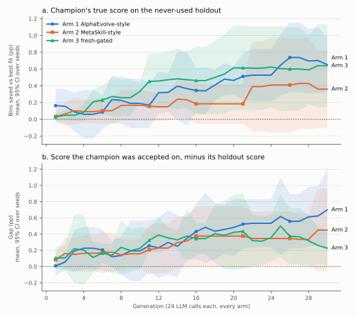

# Results: fresh verification in recursive self-improvement, three arms on OpenEvolve

The pre-registration is [PREREGISTRATION.md](PREREGISTRATION.md). Its sha256 is
`f7f7edd89e1f28c43b7065a16c7946e3ba340b327712bf2c6dead236092fe283`, locked at
2026-11-06T05:33:47Z after amendments A1–A4. The main run wrote its first file 14 seconds
later. Departures made after the run are listed under [Deviations](#deviations).

## Short answer

The question was whether fresh, independent verification stops a recursive improver from
corrupting its own improvement process. This run does not show that it does.

- **The gap was not stopped.** In every arm, the score the champion was accepted on drifted
  above its score on the never-used holdout. The fresh-gated arm's gap grew about as much
  as the MetaSkill-style arm's. The likely reason is that a fresh-gated program's believed
  score includes the very draws it was selected on.
- **No arm clearly won.** On the holdout, the fresh-gated arm finished level with the
  AlphaEvolve-style arm and 0.28 pp above the MetaSkill-style arm. No difference between
  arms is significant with 5 seeds.
- **The successor test (prediction P3) was not run**, because the API credit ran out. That
  test measures whether a gated improver makes better successors.
- **The kill condition does not fire.** The opposite claim, that the governance helps, is
  not established either.
- **An unplanned observation.** In 2 of 5 MetaSkill-style seeds, the ungated improver
  degenerated until most of its proposals packed about one item per bin. No fresh-gated
  seed did. This was found after the run, in 2 seeds, so it is a lead to test, not a
  result.

## What ran

- **Domain:** online bin packing on the OR-Library recipe that FunSearch evaluated on:
  - capacity 150;
  - uniform integer item sizes;
  - 120–500 items, with the size range and count drawn per instance.
- **Score:** bins saved against best fit, in percent of the L1 lower bound ("pp"). Best fit
  is every arm's seed program and scores exactly 0, so a champion's holdout score is its
  true improvement.
  - For scale: the FunSearch OR heuristic, as reproduced here (A1), saves 0.88 ± 0.10 pp on
    this family.
- **Holdout:** 240 instances from a stream no run process could generate. They were scored
  only after the runs, and no result was fed back.
- **Runs:** 3 arms × 5 seeds × 30 generations on gpt-4o-mini, built on OpenEvolve v0.4.0.
  - Every arm made 24 model calls per generation, 720 per run.
  - The 15 runs made 10,800 calls in all. None failed.
- **Arms:** described in the pre-registration, §5.
  - **Arm 1** is AlphaEvolve-style, with prompt co-evolution.
    - Every valid child enters the population, scored on a reused 16-instance validation
      set.
    - A child counts as accepted when it beats its parent there.
  - **Arm 2** is MetaSkill-style.
    - A child enters the population only if it beats its parent on the reused validation
      set.
    - A slow loop rewrites the improver every generation, and the rewrite is applied
      without a check.
  - **Arm 3** is arm 2 plus three additions:
    - a fresh-task gate on every promotion and every improver change;
    - a prediction-error budget rule;
    - an evaluator, gate and logs that the loop cannot write.

## True improvement per arm

The figures are the champion's holdout score: the program the arm believed best, scored on
240 instances it never saw. Brackets are 95% t-intervals over 5 seeds.

| Arm | Final champion, holdout (pp) | Mean over generations 1–30 (pp) | Final, per seed |
|---|---|---|---|
| 1 AlphaEvolve-style | +0.65 [+0.33, +0.98] | +0.38 [+0.21, +0.55] | 0.38, 0.37, 0.80, 0.93, 0.78 |
| 2 MetaSkill-style | +0.36 [−0.10, +0.82] | +0.22 [+0.01, +0.44] | 0.00, 0.21, 0.13, 0.54, 0.92 |
| 3 Fresh-gated | +0.64 [+0.15, +1.13] | +0.43 [+0.15, +0.70] | 1.08, 0.40, 0.25, 1.06, 0.40 |

Differences between arms are Welch 95% intervals:

| Contrast | Final champion (pp) | Mean over generations (pp) |
|---|---|---|
| Arm 3 − arm 2 | +0.28 [−0.28, +0.84] | +0.20 [−0.09, +0.50] |
| Arm 3 − arm 1 | −0.01 [−0.52, +0.49] | +0.05 [−0.23, +0.33] |
| Arm 1 − arm 2 | +0.29 [−0.19, +0.77] | +0.15 [−0.08, +0.39] |

Every interval spans zero. Arm 2's seed 0 never accepted a child in 600 proposals, so its
champion stayed best fit (0.00). This pulls arm 2's mean down, and is discussed under
[Exploratory](#exploratory-the-ungated-improver-degenerated-in-two-seeds).

## Pre-registered measures

The table is `results.md` as written by `python -m rsi_oe.analyze`. Rows for the
successor test are left out because it has no data. "pp" is the score unit above. Brackets
are 95% intervals over seeds.

| Measure (mean [95% CI over seeds]) | 1 AlphaEvolve-style | 2 MetaSkill-style | 3 Fresh-gated (ours) |
|---|---|---|---|
| Final champion, holdout (pp vs best fit) | 0.651 [0.327, 0.975] | 0.360 [-0.102, 0.822] | 0.638 [0.145, 1.132] |
| Mean champion holdout over generations | 0.377 [0.207, 0.548] | 0.224 [0.006, 0.442] | 0.427 [0.152, 0.702] |
| Gap: believed − holdout, gens 1–10 | 0.155 [-0.059, 0.370] | 0.153 [-0.032, 0.338] | 0.171 [-0.040, 0.382] |
| Gap: believed − holdout, gens 21–30 | 0.579 [0.235, 0.924] | 0.368 [0.017, 0.718] | 0.347 [0.042, 0.653] |
| Gap slope per generation | 0.0210 [0.0052, 0.0368] | 0.0108 [0.0002, 0.0214] | 0.0079 [-0.0107, 0.0266] |
| Acceptance precision, gens 1–10 | 0.82 [0.63, 1.02] | 0.78 [0.64, 0.91] | 0.88 [0.77, 0.98] |
| Acceptance precision, gens 21–30 | 0.72 [0.59, 0.86] | 0.66 [0.15, 1.18] | 0.79 [0.48, 1.09] |
| Prediction MAE vs own measure, gens 1–10 | 2.872 [1.739, 4.005] | 1.286 [-0.156, 2.728] | 3.504 [-1.060, 8.068] |
| Prediction MAE vs own measure, gens 21–30 | 2.842 [-0.057, 5.740] | 30.177 [-29.878, 90.231] | 2.583 [0.021, 5.144] |
| Instance evaluations per hour | 6420 [5905, 6935] | 4953 [2549, 7357] | 32422 [27026, 37818] |
| Fresh tasks consumed per hour | 0 [0, 0] | 0 [0, 0] | 8313 [6504, 10122] |
| Loop cost, USD per run | 0.558 [0.496, 0.620] | 0.398 [0.322, 0.474] | 0.403 [0.355, 0.450] |
| Loop tokens per run | 2659113 [2341462, 2976764] | 1842340 [1370181, 2314499] | 1922203 [1667716, 2176690] |

- **The precision intervals run past 1.** They are t-intervals on per-run fractions, and
  the per-run values are spread widely.
- **Arm 2's late prediction error comes from two runs.** Their improvers proposed
  catastrophic children, scoring −146 to −158 pp, while still predicting small gains.
- **Arm 3's prediction error vs the holdout fell** from 3.02 pp in generations 1–10 to 0.90
  pp [0.01, 1.79] in generations 21–30. Arm 1's fell from 2.16 to 1.64 pp.

Counts behind those measures, per run:

| Count per run (mean [95% CI over seeds]) | 1 AlphaEvolve-style | 2 MetaSkill-style | 3 Fresh-gated (ours) |
|---|---|---|---|
| Proposals per run | 690 [690, 690] | 600 [600, 600] | 600 [600, 600] |
| Valid proposals per run | 588 [564, 611] | 485 [415, 555] | 532 [486, 577] |
| Accepted on the arm's own test | 99.8 [37.2, 162.4] | 60.0 [-8.1, 128.1] | 84.4 [18.3, 150.5] |
| Accepted that were truly better on the holdout (pooled) | 0.81 [0.69, 0.93] | 0.79 [0.64, 0.94] | 0.82 [0.70, 0.94] |
| Accepted that were truly worse on the holdout (pooled) | 0.19 [0.07, 0.31] | 0.18 [-0.04, 0.40] | 0.18 [0.06, 0.30] |
| Mean true change of an accepted child (pp) | 1.629 [-0.665, 3.923] | 0.124 [-0.006, 0.254] | 0.178 [0.019, 0.337] |
| Rejected (15% sample) that were truly better | 0.14 [0.03, 0.26] | 0.14 [-0.03, 0.31] | 0.16 [0.04, 0.29] |
| Mean true change of a rejected child (pp) | -3.918 [-6.141, -1.696] | -13.338 [-35.179, 8.504] | -2.754 [-6.442, 0.934] |
| Improver versions written | 1.0 [1.0, 1.0] | 31.0 [31.0, 31.0] | 31.0 [31.0, 31.0] |
| Gate: promotions tested | — | — | 566 [536, 597] |
| Gate: promotions passed | — | — | 84.4 [18.3, 150.5] |
| Gate: rejected, fresh gain too small | — | — | 447 [355, 540] |
| Gate: rejected by the retention veto | — | — | 34.6 [-5.8, 75.0] |
| Gate: improver changes tested | — | — | 29 [29, 29] |
| Gate: improver changes adopted | — | — | 5.4 [0.5, 10.3] |
| Post hoc: children worse than parent by >10 pp, gens 21–30 | 0.07 [-0.02, 0.15] | 0.26 [-0.25, 0.77] | 0.03 [-0.01, 0.08] |
| Post hoc: children worse than parent by >50 pp, gens 21–30 | 0.01 [-0.00, 0.02] | 0.24 [-0.28, 0.76] | 0.01 [-0.01, 0.03] |

The two post-hoc rows were not pre-registered; see
[Exploratory](#exploratory-the-ungated-improver-degenerated-in-two-seeds).

Arm 1 makes 23 proposals per generation plus one prompt-mutation call. Arms 2 and 3 make
20 proposals plus four improver calls. The calls are equal; the tokens are not: arm 1
used about 40% more.

Arm 1 admits every valid child to its population, so it often extends weak parents.
Repairing a weak parent is a large gain, which is why its mean accepted change is high.

## The pre-registered tests

Tests are one-sided at α = 0.05, with seeds as the units (§6).

| Test | Result | Holds? |
|---|---|---|
| **H1** (P1): the gap grows in arm 1 | slope p = 0.011; gap 0.16 → 0.58 pp | **Yes** |
| **H1** (P1): the gap grows in arm 2 | slope p = 0.024; gap 0.15 → 0.37 pp | **Yes** |
| **H2** (P2): arm 3's gap stays flat and grows less than arm 2's | arm 3's slope > 0: p = 0.15; arm 2's > arm 3's: p = 0.36 | **No** |
| **H3** (P3): arm 3 makes better successors late | not measured | — |
| **Kill**: arm 2 matches arm 3 on holdout and on successors | see below | **Does not fire** |

- **H2.** It needs both halves.
  - Arm 3's slope was not significantly above zero, which satisfies the first half.
  - It was not significantly below arm 2's either, which fails the second.
  - Arm 3's late gap minus arm 2's is −0.02 pp [−0.41, +0.37].
- **Kill.** On the holdout measure, arm 3 − arm 2 = +0.20 pp, with p = 0.074.
  - That is above the 0.10 pp smallest effect of interest, but not significant. §6 calls
    this "inconclusive at this sample size", which is not a match.
  - The kill fires only if both measures match, so it cannot fire whatever the successor
    test would have shown.
  - That arm 3 beats arm 2 is not established either.

## What this shows

These hold for this regime: one problem family, gpt-4o-mini, 16 instances per decision,
30 generations and 5 seeds.

1. **Accepting on a reused validation set lets the believed score drift from the truth.**
   - In arms 1 and 2, the champion's believed score ran ahead of its holdout score by more
     each generation.
   - The gap went from about 0.15 pp to 0.58 pp in arm 1 and 0.37 pp in arm 2 (H1).
   - Late in the run, that is roughly as large as the true improvement itself.
2. **Fresh draws per decision did not keep the believed score honest.**
   - Arm 3's gap rose from 0.17 to 0.35 pp, level with arm 2's.
   - Arm 3 makes each decision on 16 instances no earlier decision used. But it keeps the
     child's score on those instances as the child's believed score. It accepts only
     children that did well on them, and it calls the highest such score its champion.
     Both steps select on noise, and that is the likely source of the gap.
   - The five seeds are loosely consistent with this, as an illustration rather than a
     test. Here are each seed's final champion, the number of fresh instances its believed
     score rests on, and its final gap:
     - 16 instances, its acceptance draws alone: 0.44 pp;
     - 48 instances: 0.16 and 0.39 pp;
     - 64 instances: 0.12 pp;
     - 272 instances: 0.03 pp.
   - The fix this suggests is to score an accepted child on draws not used to accept it.
     That is the next experiment, not a result.
3. **The gate did not buy acceptance precision.**
   - In all three arms, about 80% of accepted children were truly better on the holdout,
     and about 18% were truly worse.
   - Arm 3's gate passed 422 of 2,832 promotions (15%). 2,237 failed the fresh-gain test
     and 173 failed the retention veto.
   - Of a 15% sample of rejected children, 16% were truly better, against 14% in arms 1–2.
4. **The budget rule bound in every generation.**
   - The proposer's own predictions of its gain had no skill: calibration skill had median
     −0.04, which is no better than always predicting the median change.
   - So arm 3 ran at one child per parent throughout. Arm 2's allocator averaged 2.8.
5. **Freshness cost CPU, not model calls.**
   - Arm 3 consumed about 9,800 fresh instances per run, and 5 to 6.5 times the instance
     evaluations per hour of arms 1–2.
   - Its model cost was the same as arm 2's, $0.40 per run, and its wall-clock time similar
     (1.2 h against 1.1 h).
   - In a domain where a fresh task costs microseconds, the gate is close to free.
6. **The harness is usable as built.**
   - 15 runs completed with 0 failed calls.
   - Each run resumes from its last finished generation.
   - The offline test suite covers each arm, the gate, the sandbox and the analysis.

## What this does not show

- **That fresh verification prevents the gap.** It did not here.
- **That governance adds nothing.** The kill condition does not fire. At 5 seeds, arm 3's
  lead over arm 2 on the holdout is inconclusive (p = 0.074).
- **Anything about successor quality (P3).** The successor test was not completed. Its
  partial rows are not analysed, because which ones finished depended on scheduling order
  rather than design.
- **That the gated improver resists degeneration.** The hint below is post hoc and rests on
  2 seeds.
- **Results beyond this regime.** That means other problem families, other models, larger
  validation or gate sets, longer runs or more seeds.
  - The penalty for reusing tasks shrinks as the reused set grows (certificate §8.4).
  - The gate uses a per-decision t threshold with no cumulative error budget, unlike SGM
    (arXiv:2510.10232).
  - MetaSkill-Evolve is reimplemented from its paper, with the simplifications in §8.
  - Arm 1 used about 40% more tokens than arms 2 and 3 at equal calls.

## Exploratory: the ungated improver degenerated in two seeds

This analysis was not pre-registered. The threshold was chosen after looking at the data,
and the sensitivity to it is shown.

- **Measure:** the share of valid children that scored far worse than their parent on the
  arm's own test, in generations 1–10 against 21–30.
- **Arm 2, seed 0.**
  - In generation 1, before any self-edit took effect, 18 of its 20 children packed
    exactly as best fit did and 2 did slightly worse, so none was accepted.
  - None of its 480 scored children in the whole run beat its parent.
  - With no accepted child to learn from, the slow loop rewrote the improver 30 times
    without a check: 18 proposer edits and 12 editor edits.
  - Its last version tells the model to pass in a list of future item sizes and penalise
    their variance. An online packer cannot know future items.
  - In generations 21–30, 97% of its valid children were more than 50 pp worse than their
    parent, at the level of one item per bin, and the valid rate fell from 0.91 to 0.61.
- **Arm 2, seed 1** reached 22% on the same measure.

| Late share of children worse than parent by more than | Arm 1, per seed | Arm 2, per seed | Arm 3, per seed |
|---|---|---|---|
| 10 pp | 0.02 0.03 0.17 0.11 0.01 | **0.97 0.29** 0.02 0.02 0.01 | 0.00 0.06 0.04 0.07 0.00 |
| 50 pp | 0.00 0.00 0.02 0.02 0.01 | **0.97 0.22** 0.01 0.00 0.00 | 0.00 0.01 0.04 0.00 0.00 |

- **Arm 3's improver gate is built to stop such edits.** It scores each proposal as
  max(0, child − parent) on fresh instances, so a candidate whose children are
  catastrophic scores 0 and cannot be adopted over the incumbent. It adopted 27 of 145
  improver changes.
- **The cost in arm 2 was wasted budget, not a corrupted population.** Arm 2's acceptance
  test still rejected the catastrophic children, so they never entered the population.
- **What it does not establish.** A gate stopping an improver from corrupting its own
  proposals is what P3 was designed to test. These two seeds point that way but do not
  show it.

## Deviations

- **D1. The successor test was not completed.**
  - The OpenAI account ran out of credit after 364 of 2,665 successor proposals ($0.23).
  - The harness recorded each later failed call as an invalid proposal. Those rows were
    removed and kept aside, and the bug is fixed:
    - the successor test now records nothing for a group with a failed call;
    - a run stops after eight failed calls in a row and resumes from its last generation;
    - both have tests.
  - The loop itself had no failed calls, so its data is unaffected.
  - Finishing would have cost about $1.50. The project lead chose to skip it.
  - So H3 and the successor half of the kill are not measured. The kill is still decided,
    by its holdout half.
- **D2. Analysis code was added after the run.**
  - Additions: the descriptive counts, the between-arm intervals, how many instances a
    champion's estimate rests on, and "not measured" handling.
  - "Not measured" settles the kill from its holdout half, which follows from §6's rule
    that the kill fires only if both measures match.
  - No pre-registered measure, test or threshold changed.
- **D3. The exploratory section is post hoc**, as stated there.

## Cost

| Item | Calls | USD at list price |
|---|---|---|
| Main loop, 15 runs | 10,800 | 6.792 |
| Successor test, before the credit ran out | 364 | 0.225 |
| Pilots, excluded from analysis | 604 | 0.276 |
| **Total** | 11,768 | **7.293** |

The model was gpt-4o-mini at $0.15 per 1M input tokens and $0.60 per 1M output tokens. The
loop used 32.1M tokens. Holdout scoring ran locally and has no model cost.

## Reproduce

The commands are in [README.md](README.md). `results.json` holds every per-run and
per-generation number above, as written by `python -m rsi_oe.analyze`. The raw run logs
(62 MB: programs, children, gate and ledger logs) are not committed.
